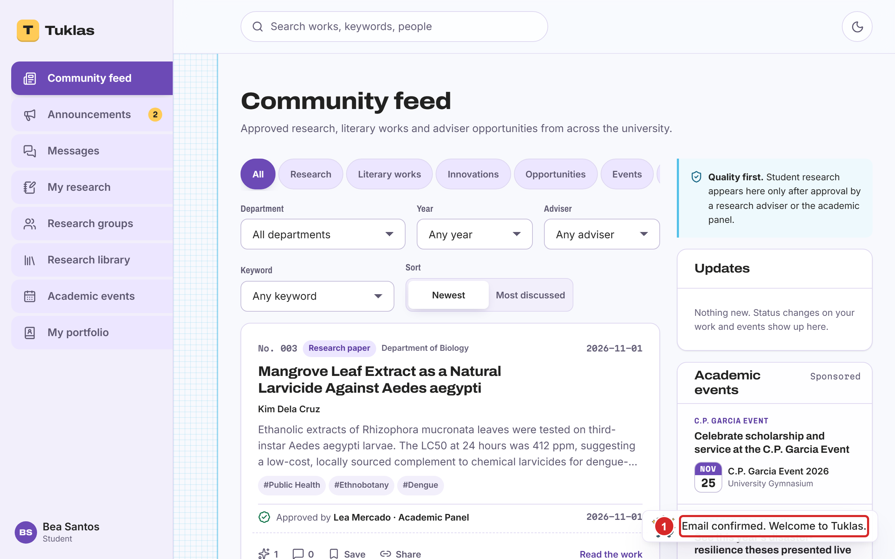
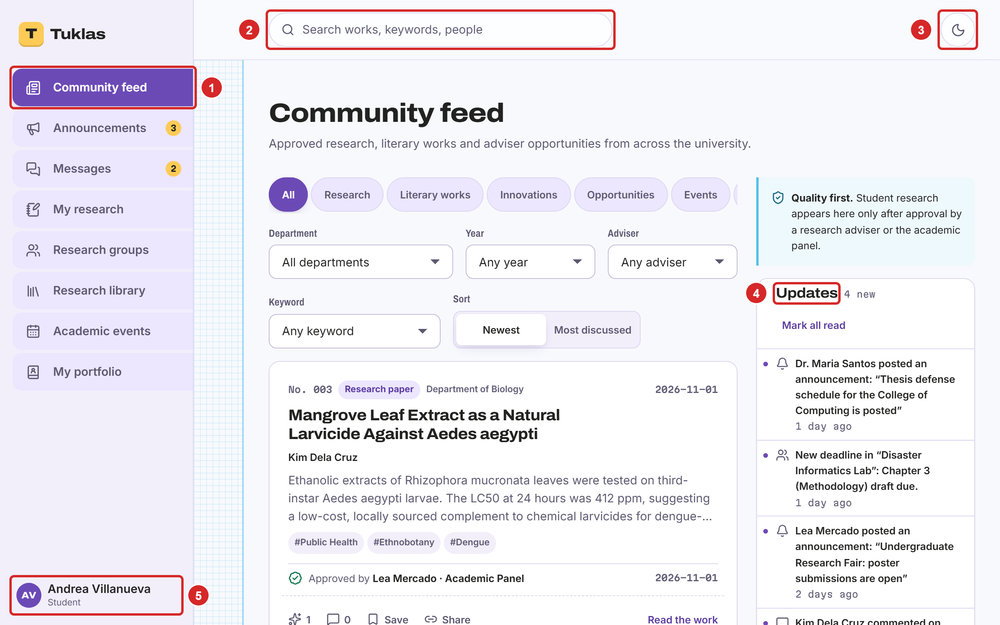

# Getting Started

## What You Need

- A computer or phone with a current version of Google Chrome, Microsoft Edge, Mozilla Firefox or Apple Safari.
- Your school email address. Without one you can still sign up, but your school's admins must confirm you first (section 2.3).
- **Educators and admins:** a phone with an authenticator app, such as Google Authenticator, Microsoft Authenticator or 2FAS. Tuklas asks for a code from it each time you log in (section 2.6). Students can use one too, but don't have to.

## Creating Your Account

Students and educators create their own accounts. Admin accounts are issued by the research office and are never created this way.

1. Open Tuklas in your browser and select "Create your account" (Figure 1, number 5).
2. Enter your **full name** (Figure 2, number 1).
3. Enter your **school email** (2). Tuklas recognizes your school from it, and fills in "School" for you (4).
4. Choose a **password** (3) of at least 12 characters. A short phrase that you'll remember, such as four unrelated words, works well. Tuklas refuses passwords that have appeared in known data breaches.
5. Under "I am a" (5), choose "Student" or "Educator / Research adviser".
6. Enter your **program or department** (6), for example "BS Psychology".
7. Read the privacy notice (select its link), then tick the box (7) to agree to it.
8. Select "Create account" (8).

> **Note for educators:** after you sign up, an admin of your school checks that you are an educator before you can review students' work. You can use the rest of Tuklas while you wait.

## If You Don't Have a School Email

You can sign up with another email address, such as a personal one. Choose your school under "School" (Figure 3). Its admins then confirm your account before you can use Tuklas. This usually takes a day or two, and you'll get an email when it's done.

While you wait, Tuklas shows the screen in Figure 4. Select "Check again" (1) to see whether you've been confirmed.

> **Note:** if you picked the wrong school, ask your school's research office, or sign up again with your school email.

## Confirming Your Email

After you create your account, Tuklas sends you an email with a link (Figure 5).

1. Open the email from Tuklas and select the link in it. Open it in the same browser you signed up in.
2. Tuklas opens and shows "Email confirmed. Welcome to Tuklas." (Figure 6).

If the email doesn't arrive within a few minutes, check your spam folder, then select "Send a new link" (Figure 5, number 2). Only the newest link works. If you confirmed the email in another browser or on your phone, select "I've confirmed it" (1).

## Logging In

1. Enter your email address (Figure 1, number 1) and your password (2).
2. Select "Log in" (4).
3. If you use two-factor sign-in, Tuklas then asks for a code (section 2.7).

## Setting Up Two-Factor Sign-In

With two-factor sign-in, logging in needs a 6-digit code from an app on your phone as well as your password, so someone who learns your password still can't get in. Educators and admins must set it up the first time they log in, because they can approve and publish research. Students can turn it on in their account settings (section 2.13).

1. Install an authenticator app on your phone if you don't have one.
2. On the "Set up two-factor sign-in" screen, select "Set up two-factor sign-in" (Figure 7, number 1). If Tuklas asks for your password first, enter it and select "Continue".
3. In the authenticator app, add an account, and scan the QR code on the screen (Figure 8, number 1). If you can't scan it, type in the key shown under it (2) instead.
4. Enter the 6-digit code that the app shows (3), and select "Turn on" (4).
5. Tuklas shows your **recovery codes** (Figure 9). Save them somewhere safe, away from your phone: select "Copy" (1) or "Download" (2), and keep them in a password manager or print them. Each code lets you log in once if you lose your phone.
6. Select "I've saved my codes" (3).

> **Note:** a code changes every 30 seconds and works only once. If a code is refused, wait for the next one.

## Logging In with Two-Factor Sign-In

1. Log in with your email and password as usual.
2. Open your authenticator app, and enter the 6-digit code for Tuklas (Figure 10, number 1).
3. Select "Log in".

If you've lost your phone, select "Lost your phone? Use a recovery code" (2), and enter one of your recovery codes instead. Each one works once. Then, in your account settings (section 2.13):

- **Students:** turn two-factor sign-in off, then set it up again on your new phone.
- **Educators and admins:** select "Show recovery codes", then "Make new codes", and save the new codes. To move two-factor sign-in to a new phone, contact TBD-7.

## Accepting the Privacy Notice

Tuklas asks you to accept its privacy notice when you sign up. When the notice changes, it asks again the next time you log in (Figure 11).

1. Read the notice.
2. Tick the box (1) to agree, then select "Accept and continue" (2).

## If You Forget Your Password

1. On the login page, select "Forgot your password?" (Figure 1, number 3).
2. Enter your school email and select "Send reset link" (Figure 12).
3. Open the email from Tuklas and select its link. The link works once, for 60 minutes.
4. Enter a new password twice, and save it. Then log in with the new password.

## Finding Your Way Around

**On a computer** (Figure 13):

1. The menu on the left takes you to each part of Tuklas. Which items it shows depends on your role. Numbers next to "Announcements" and "Messages" count what you haven't read.
2. Search finds works, keywords and people.
3. This button switches between light and dark mode.
4. "Updates" lists your notifications: reviews, comments, deadlines, announcements and more.
5. Your name opens your menu: appearance, "Account and security", and "Log out".

**On a phone** (Figure 14), search (1) and your menu (2) are at the top. The bar at the bottom holds the main items (3); "More" (4) opens the rest.

## Changing How Tuklas Looks

1. Select your name (on a phone, your initials) to open your menu.
2. Under "Theme" (Figure 15, number 1), choose "Light", "Dark", or "Auto" to follow your device.
3. Under "Look" (2), choose "Modern", or "Classic" for a style that recalls early academic networking sites.

Your choice is saved on this device only.

## Installing Tuklas on Your Phone or Computer

Tuklas can be installed like an app, so that it opens from your home screen or desktop and can send notifications to your phone.

- **Android phones, and computers with Chrome or Edge:** open Tuklas, then in the browser's menu choose "Install app" or "Add to Home screen".
- **iPhone and iPad:** open Tuklas in Safari, select the Share button, then "Add to Home Screen". On these devices, notifications work only after Tuklas is installed this way.

## Your Account and Security

To open your account settings, select your name, then "Account and security" (Figure 16).

- **Two-factor sign-in** (1): set it up, or once it's on, "Show recovery codes" and "Make new codes" (the old codes then stop working). Students can also "Turn off" two-factor sign-in; educators and admins can't.
- **Password** (2): enter your current password and a new one twice, then select "Change password".
- **Where you're signed in:** every browser and device logged in to your account. If you don't recognize one, or used a shared computer, select "Sign out other browsers" and change your password.

### Notifications

Every update appears in Tuklas itself. Under "Notifications" (Figure 17), choose which kinds also reach you another way:

1. Select "Turn on notifications here" (1) to get notifications on this device. Do it on each device you want them on.
2. For each kind of update, switch "Email" (2) or "Push" (3) on or off.

### Your Data and Deleting Your Account

- **Weekly digest email** (Figure 18, number 1): a Monday-morning email with the updates you haven't read, the week's deadlines and events, and new research from your department.
- **Download my data** (2): a file with everything Tuklas holds about you. This is your right under the Data Privacy Act of 2012.
- **Delete my account** (3): erases your personal data. Your approved works stay in the library under "Former member", so citations still work. This can't be undone, so download your data first if you want a copy. Admins can't delete their own accounts; the research office closes them.

