# Getting Started

## What You Need

- A computer or phone with a current version of Google Chrome, Microsoft Edge, Mozilla Firefox or Apple Safari.
- Your school email address. Without one you can still sign up, but your school's admins must confirm you first (section 2.3).
- **Educators and admins:** a phone with an authenticator app, such as Google Authenticator, Microsoft Authenticator or 2FAS. Tuklas asks for a code from it each time you log in (section 2.6). Students can use one too, but don't have to.

## Creating Your Account

Students and educators create their own accounts. Admin accounts are issued by the research office and are never created this way.

Open Tuklas in your browser and select "Create your account" at the bottom of the login page. Then, in the form that opens:

1. Enter your full name.
2. Enter your school email.
3. Choose a password of at least 12 characters. A short phrase that you'll remember, such as four unrelated words, works well. Tuklas refuses passwords that have appeared in known data breaches.
4. Check that "School" shows your school. Tuklas fills it in from your email address.
5. Under "I am a", choose "Student" or "Educator / Research adviser".
6. Enter your program or department, for example "BS Psychology".
7. Read the privacy notice (select its link), then tick the box to agree to it.
8. Select "Create account".

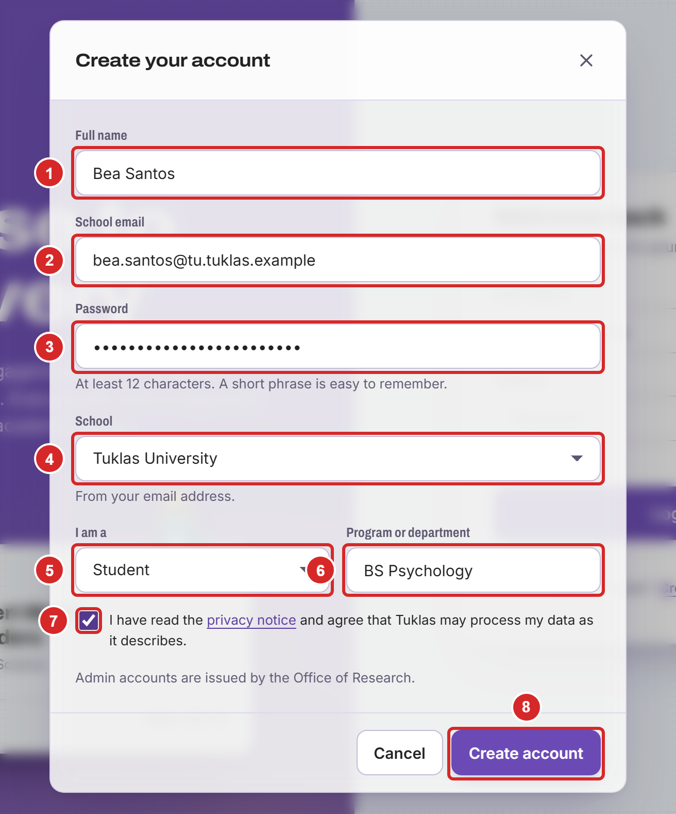

> **Note for educators:** after you sign up, an admin of your school checks that you are an educator before you can review students' work. You can use the rest of Tuklas while you wait.

## If You Don't Have a School Email

You can sign up with another email address, such as a personal one. Fill in the form as in section 2.2 with that address, then:

1. Under "School", choose your school.
2. Select "Create account".

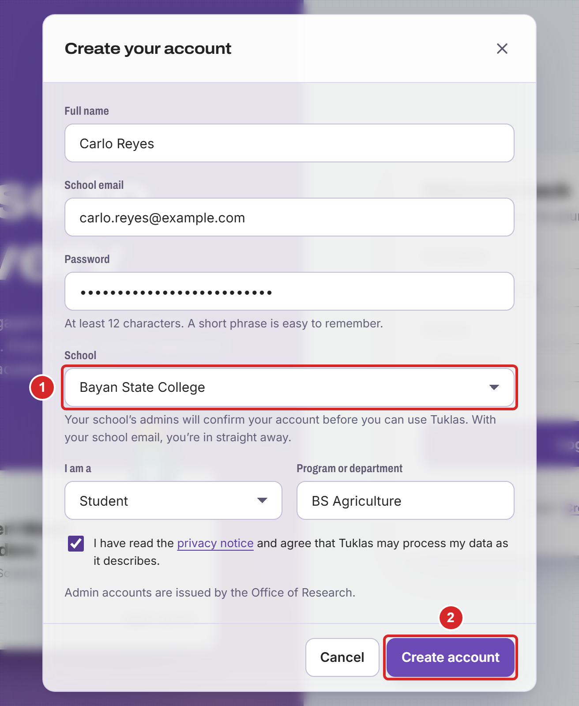

Your school's admins then confirm your account before you can use Tuklas. This usually takes a day or two, and you'll get an email when it's done. Until then, after you have confirmed your email (section 2.4), Tuklas shows that you are waiting for your school:

1. Select "Check again" to see whether you've been confirmed.

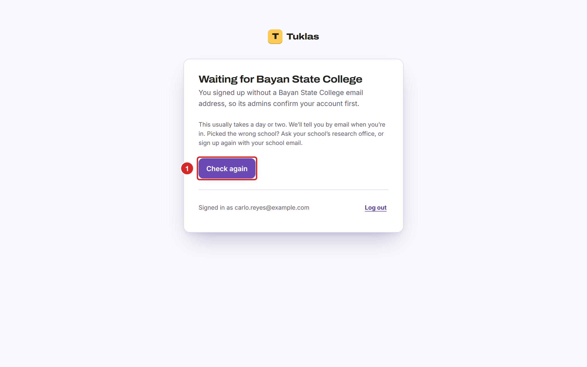

> **Note:** if you picked the wrong school, ask your school's research office, or sign up again with your school email.

## Confirming Your Email

After you create your account, Tuklas sends you an email with a link. Open the email and select the link, in the same browser you signed up in. Tuklas opens and shows "Email confirmed. Welcome to Tuklas."

While Tuklas waits for you to confirm, it shows the screen below. If the email doesn't come:

1. Check your spam folder, then select "Send a new link". Only the newest link works.
2. If you opened the link in another browser or on your phone, select "I've confirmed it".

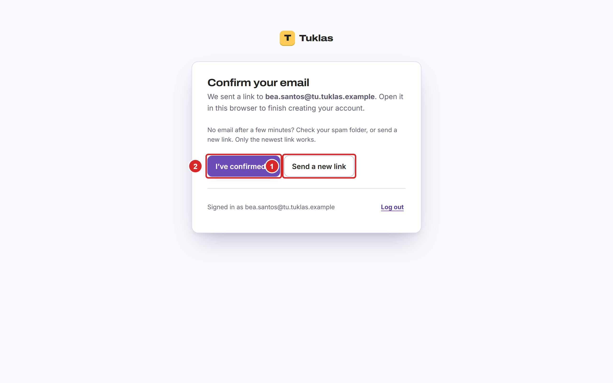

## Logging In

1. Enter your email address.
2. Enter your password.
3. Select "Log in". If you use two-factor sign-in, Tuklas then asks for a code (section 2.7).

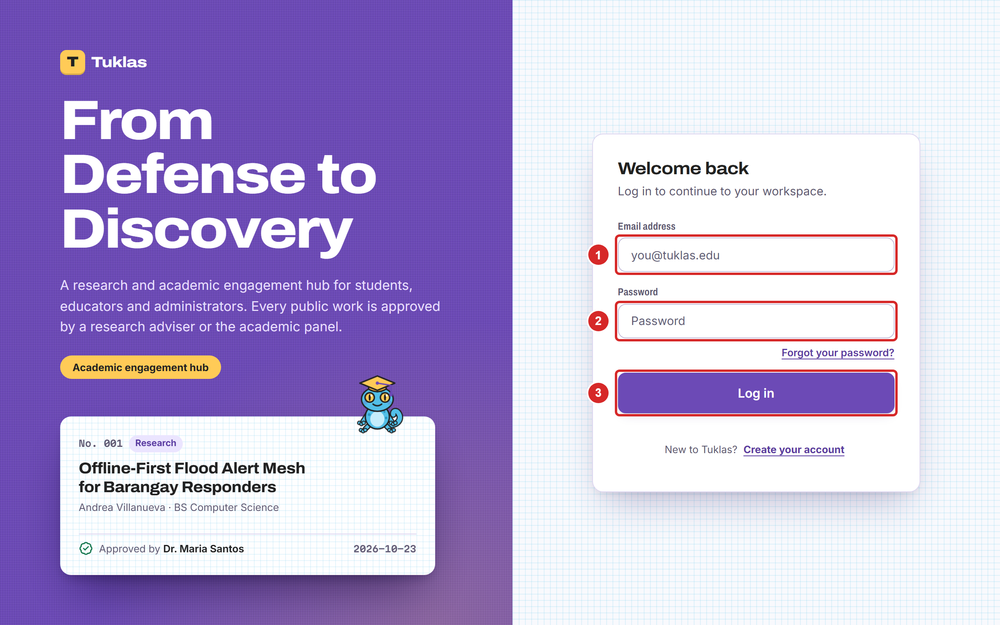

## Setting Up Two-Factor Sign-In

With two-factor sign-in, logging in needs a 6-digit code from an app on your phone as well as your password, so someone who learns your password still can't get in. Educators and admins must set it up the first time they log in, because they can approve and publish research. Students can turn it on in their account settings (section 2.13).

Install an authenticator app on your phone first. Then, on the "Set up two-factor sign-in" screen:

1. Select "Set up two-factor sign-in". If Tuklas asks for your password first, enter it and select "Continue".

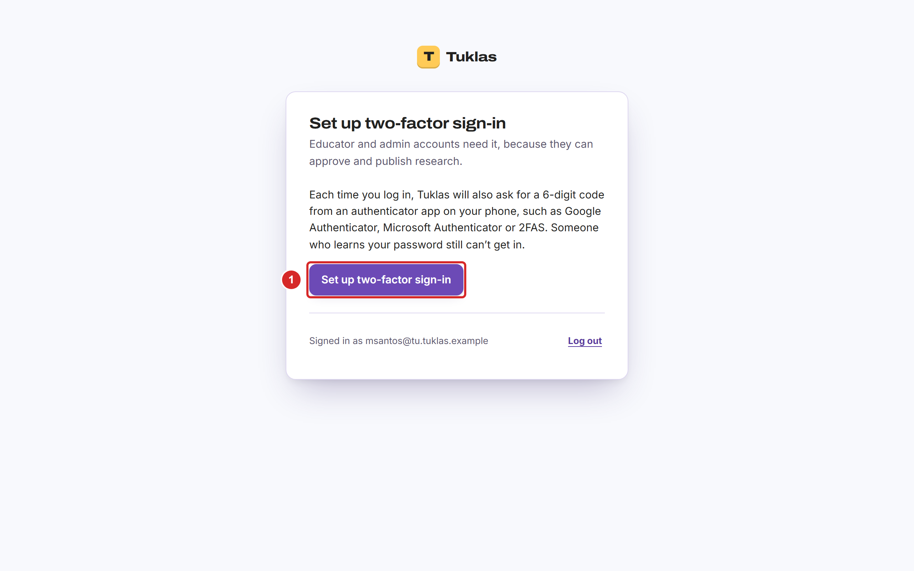

Tuklas shows a QR code. On your phone and in Tuklas:

1. In the authenticator app, add an account and scan the QR code.
2. If you can't scan it, type this key into the app instead.
3. Enter the 6-digit code that the app shows.
4. Select "Turn on".

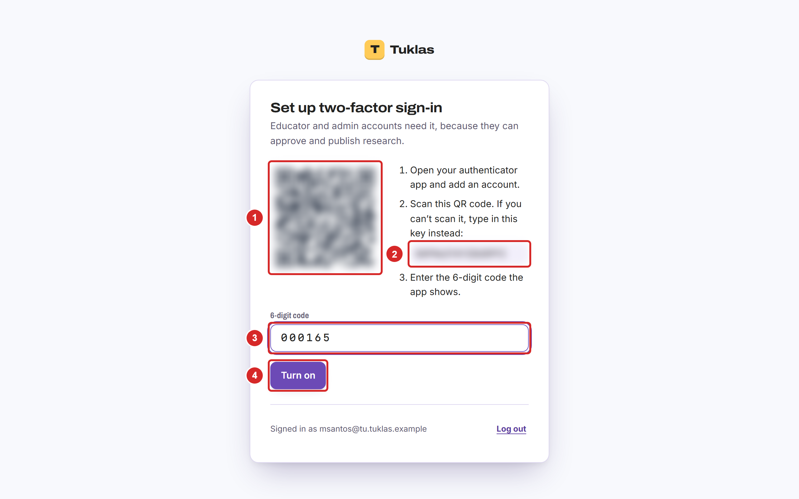

Tuklas then shows your recovery codes. Each one lets you log in once if you lose your phone, so keep them somewhere safe, away from your phone:

1. Select "Copy" and paste the codes into a password manager,
2. or select "Download" to save them as a file, which you can print.
3. Select "I've saved my codes".

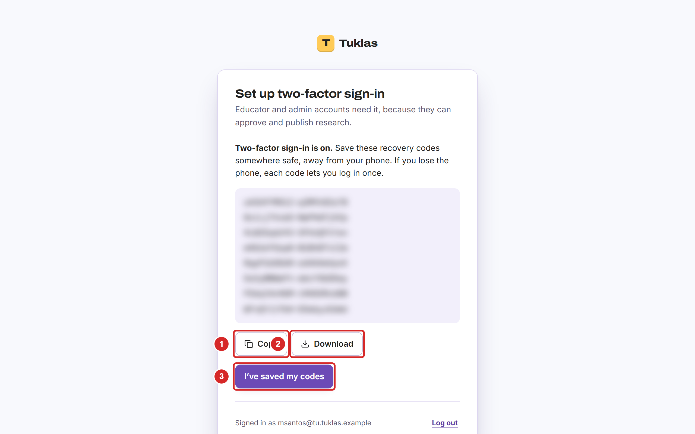

> **Note:** a code in the app changes every 30 seconds and works only once. If Tuklas refuses a code, wait for the next one.

## Logging In with Two-Factor Sign-In

After your email and password, Tuklas asks for a code:

1. Open your authenticator app, and enter the 6-digit code for Tuklas.
2. Select "Log in".
3. Lost your phone? Select "Lost your phone? Use a recovery code" and enter one of your recovery codes instead. Each one works once.

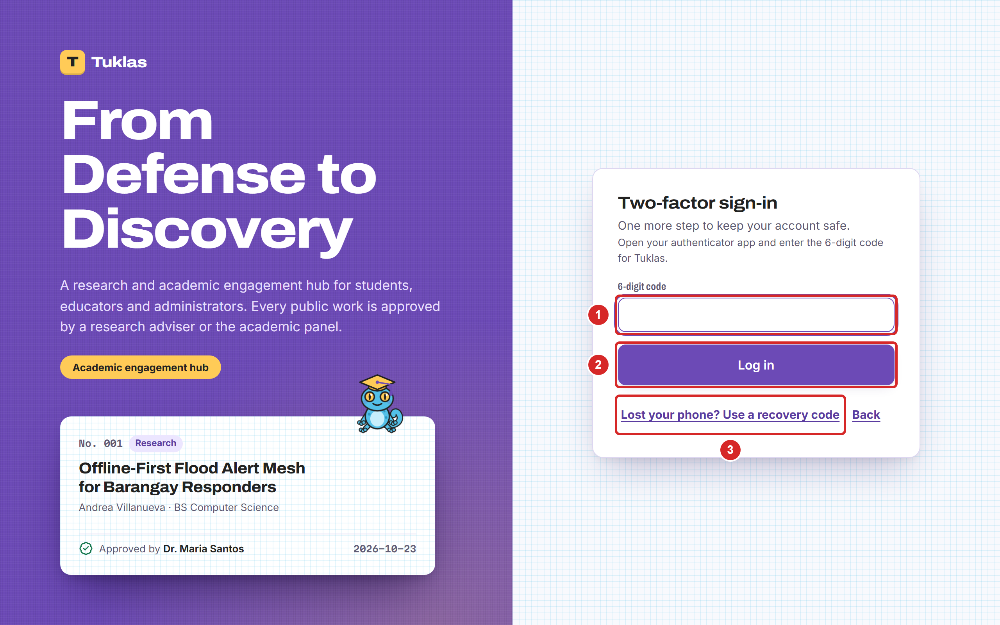

If you've lost your phone, log in with a recovery code, then open your account settings (section 2.13):

- **Students:** turn two-factor sign-in off, then set it up again on your new phone.
- **Educators and admins:** select "Show recovery codes", then "Make new codes", and save the new codes. Keep logging in with them until you get your phone back.

> **Known limitation in release 1.0:** educators and admins can't move two-factor sign-in to a new phone themselves, and admins can't reset it for them. Keep your recovery codes safe.

## Accepting the Privacy Notice

Tuklas asks you to accept its privacy notice when you sign up. When the notice changes, it asks again the next time you log in. Read the notice, then:

1. Tick the box to agree.
2. Select "Accept and continue".

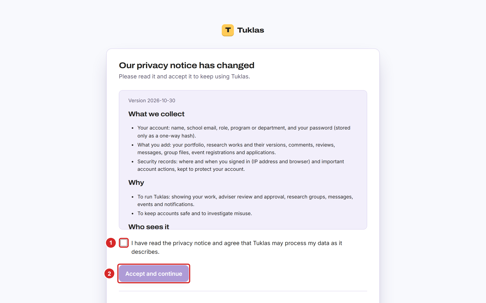

## If You Forget Your Password

On the login page, select "Forgot your password?" under the password box. Then:

1. Enter your school email.
2. Select "Send reset link".

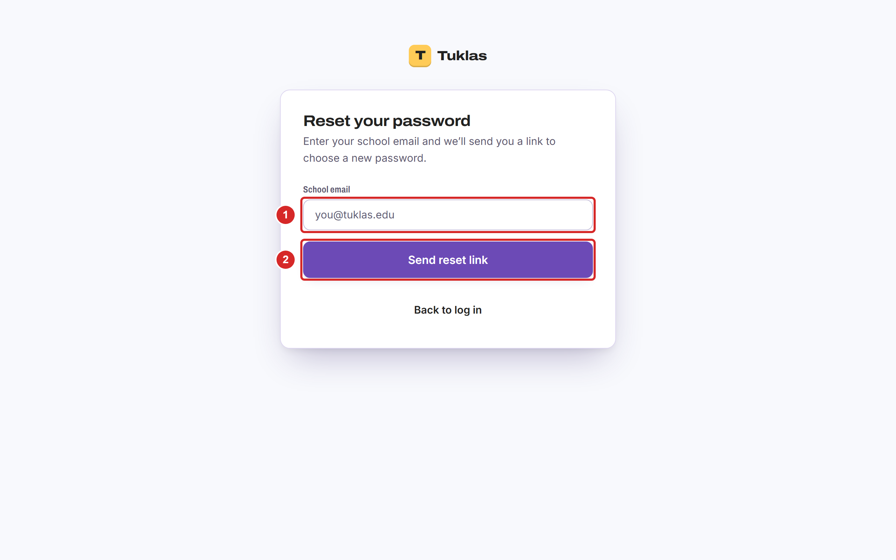

Open the email from Tuklas and select its link. The link works once, for 60 minutes. Enter a new password twice and save it, then log in with the new password.

## Finding Your Way Around

On a computer, the main screen looks like this:

1. The menu on the left takes you to each part of Tuklas. Which items it shows depends on your role. Numbers next to "Announcements" and "Messages" count what you haven't read.
2. Search finds works, keywords and people.
3. This button switches between light and dark mode.
4. "Updates" lists your notifications: reviews, comments, deadlines, announcements and more.
5. Your name opens your menu: appearance, "Account and security", and "Log out".

On a phone, the same things are arranged differently:

1. Search is at the top.
2. Your initials open your menu.
3. The bar at the bottom holds the main items.
4. "More" opens the rest of the menu.

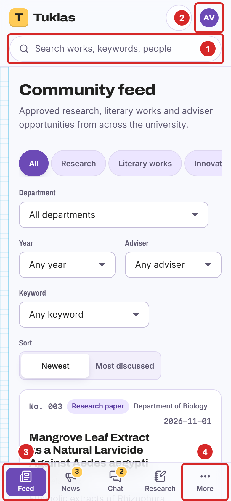

## Changing How Tuklas Looks

1. Select your name (on a phone, your initials) to open your menu.
2. Under "Theme", choose "Light", "Dark", or "Auto" to follow your device.
3. Under "Look", choose "Modern", or "Classic" for a style that recalls early academic networking sites.

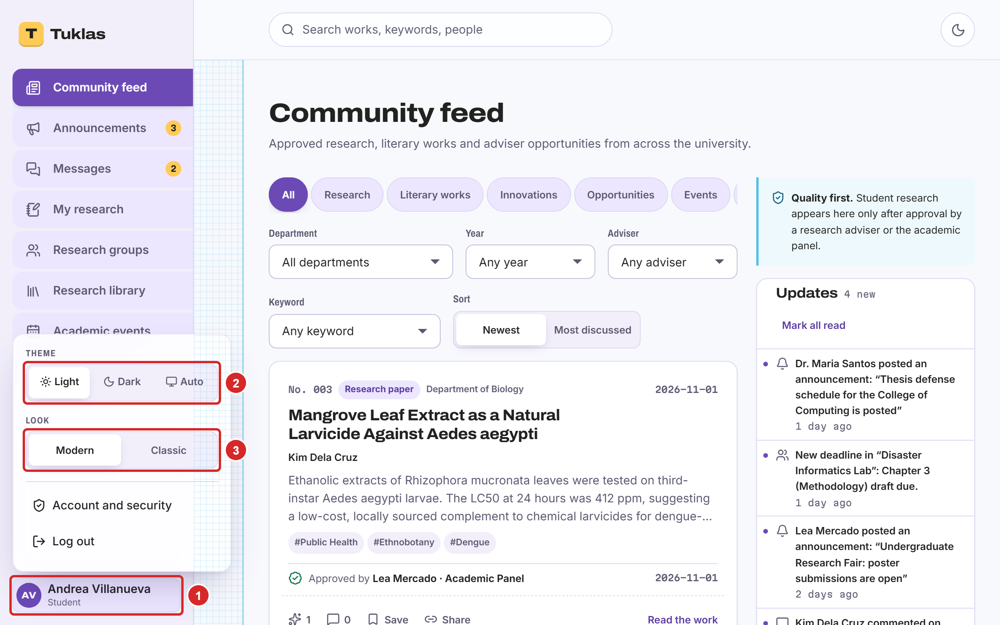

Your choice is saved on this device only.

## Installing Tuklas on Your Phone or Computer

Tuklas can be installed like an app, so that it opens from your home screen or desktop and can send notifications to your phone.

- **Android phones, and computers with Chrome or Edge:** open Tuklas, then in the browser's menu choose "Install app" or "Add to Home screen".
- **iPhone and iPad:** open Tuklas in Safari, select the Share button, then "Add to Home Screen". On these devices, notifications work only after Tuklas is installed this way.

## Your Account and Security

To open your account settings, select your name, then "Account and security". At the top of the page:

1. **Two-factor sign-in:** set it up, or once it's on, "Show recovery codes" and "Make new codes" (the old codes then stop working). Students can also "Turn off" two-factor sign-in; educators and admins can't.
2. **Password:** enter your current password and a new one twice, then select "Change password".

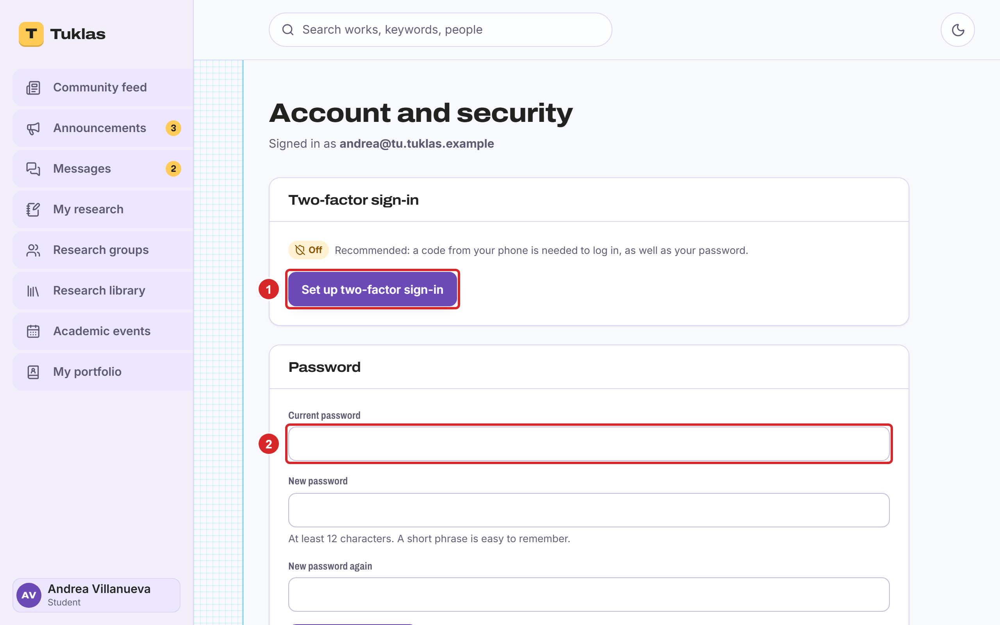

Further down, "Where you're signed in" lists every browser and device logged in to your account. If you don't recognize one, or used a shared computer, select "Sign out other browsers" and change your password.

### Notifications

Every update appears in Tuklas itself. Under "Notifications", choose which kinds also reach you another way:

1. Select "Turn on notifications here" to get notifications on this device. Do it on each device you want them on.
2. For each kind of update, switch "Email" on or off,
3. and "Push" (notifications on your devices) on or off.

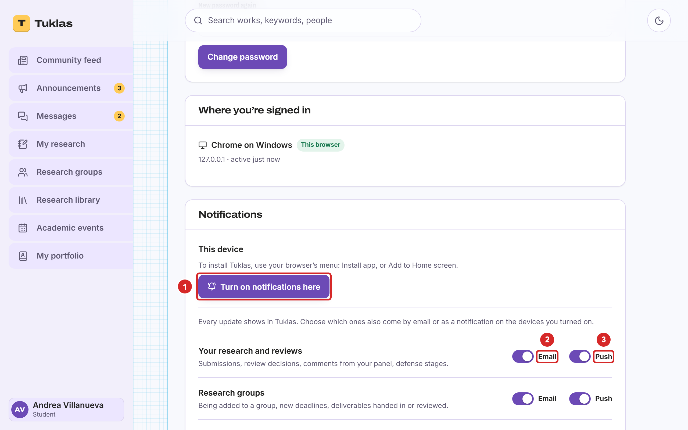

### Your Data and Deleting Your Account

1. **Weekly digest email:** a Monday-morning email with the updates you haven't read, the week's deadlines and events, and new research from your department.
2. **Download my data:** a file with everything Tuklas holds about you. This is your right under the Data Privacy Act of 2012.
3. **Delete my account:** erases your personal data. Your approved works stay in the library under "Former member", so citations still work. This can't be undone, so download your data first if you want a copy. Admins can't delete their own accounts; the research office closes them.

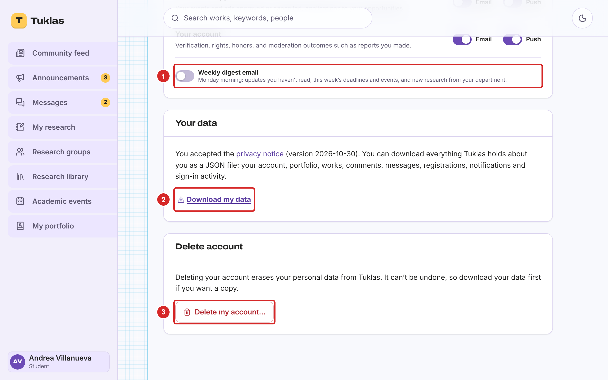
