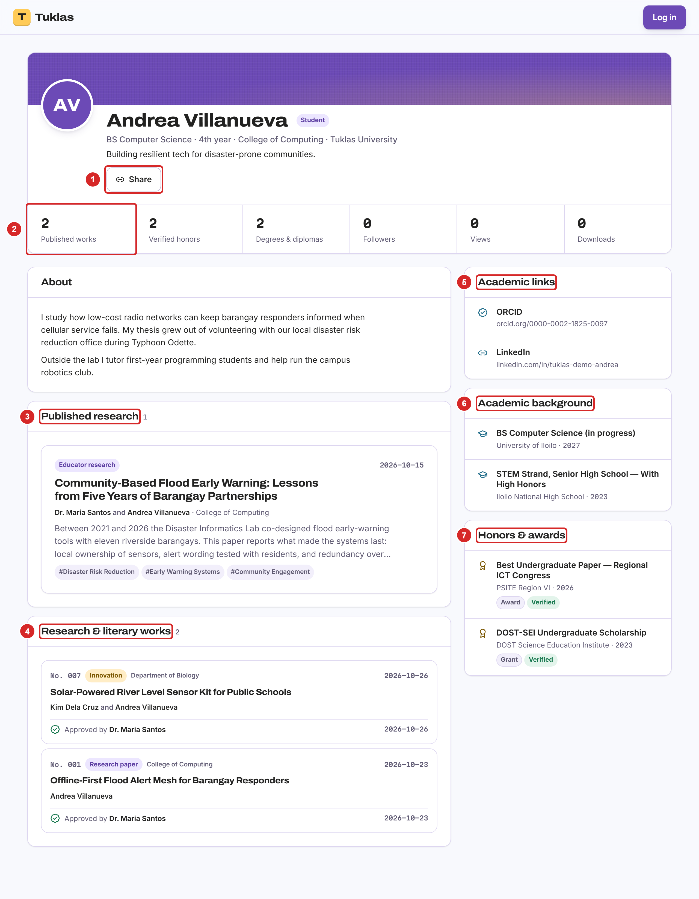
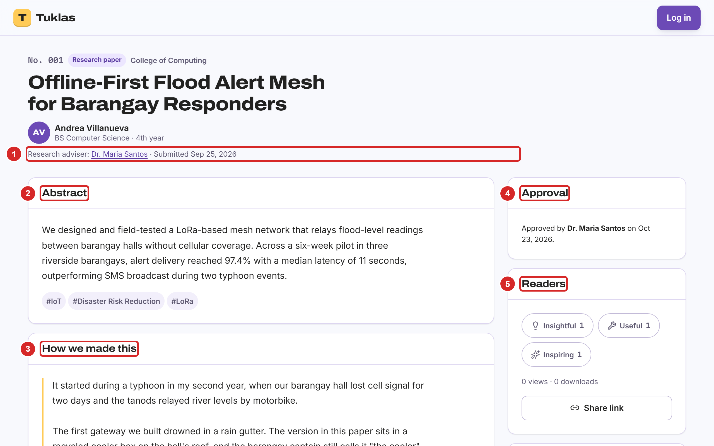
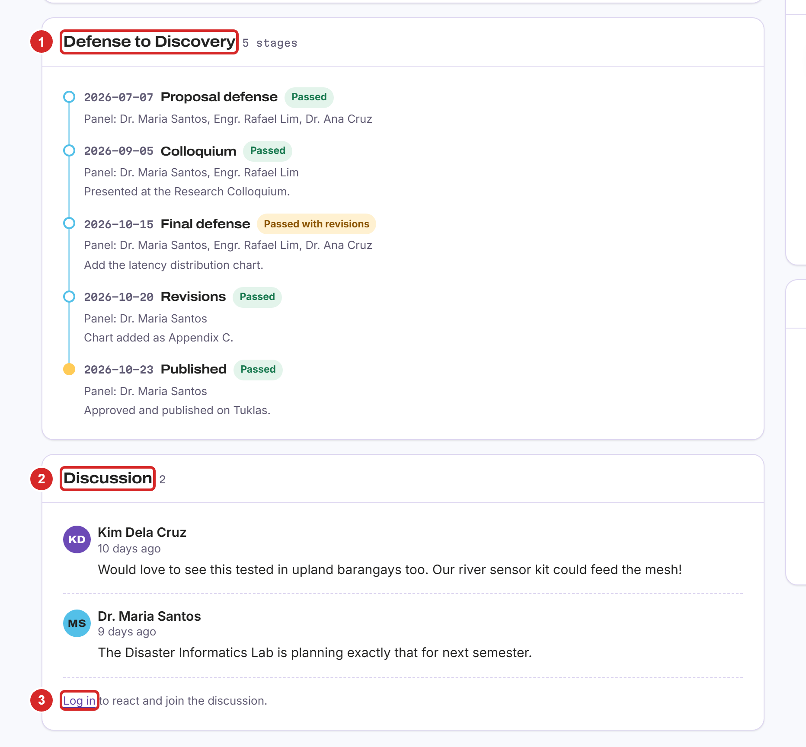
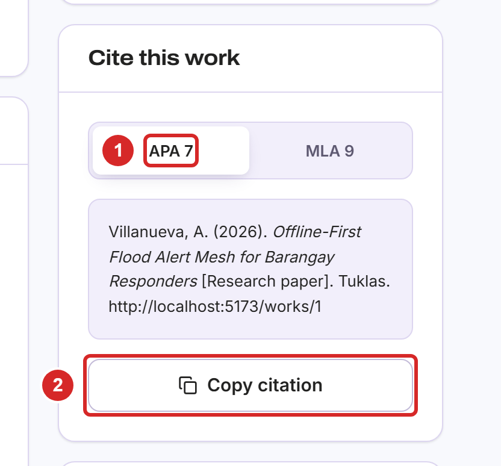
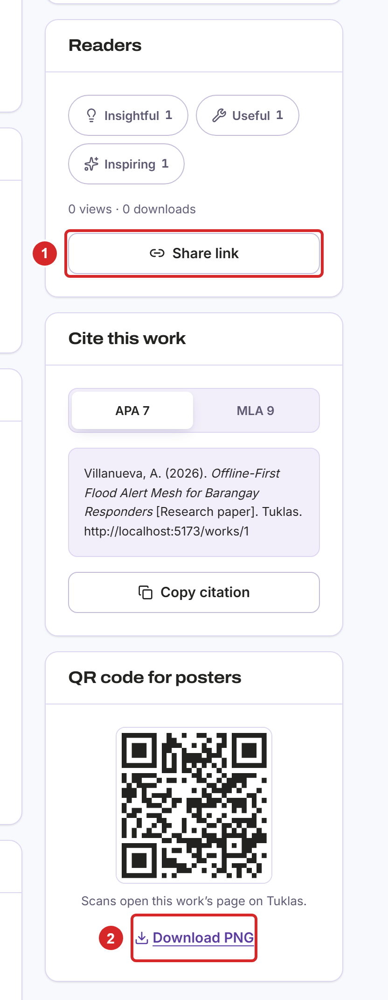
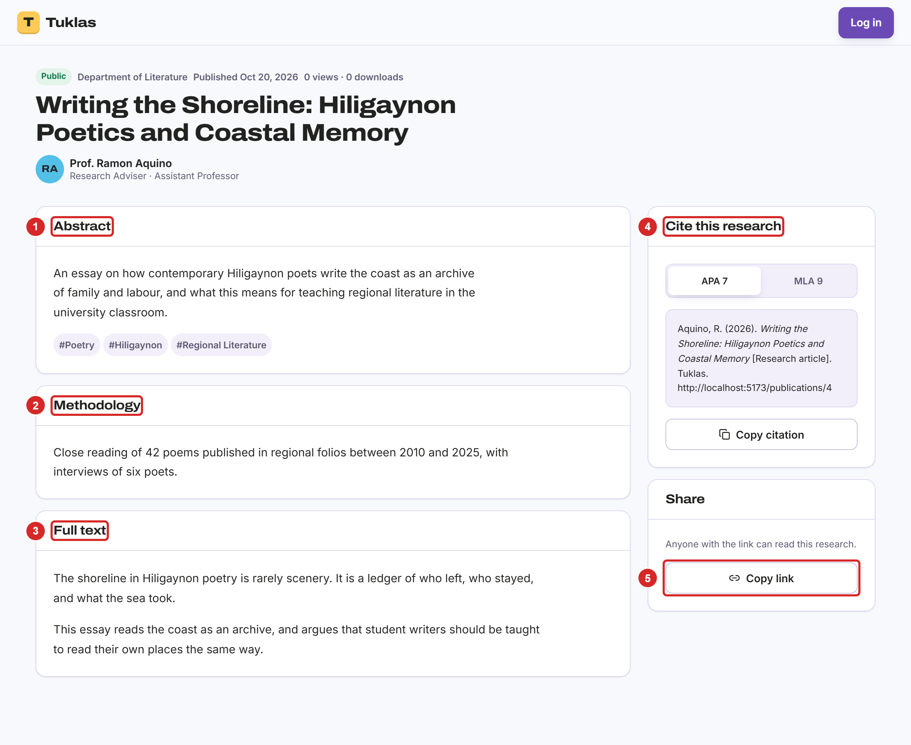

# Visitors

## What Visitors Can Do

You don't need an account to read the research that Tuklas makes public: student works that an adviser or the academic panel has approved, educators' public publications, and members' portfolios. People usually arrive from a link someone shared, a QR code on a poster, or a search engine such as Google Scholar.

Visitors can read, cite and share. Reacting, commenting, saving, following and joining groups need an account: select "Log in" at the top right of any public page, then log in or create an account (Chapter 2).

> **Note:** some works are visible only to members of their school. Visitors, and members of other schools, don't see them at all.

## Reading a Portfolio

A member's portfolio shows, from the top:

1. "Share", which copies a link to the portfolio.
2. Counts of their published works, verified honors, degrees and diplomas, followers, views and downloads.
3. "Published research": educators' research that the member wrote or co-wrote.
4. "Research & literary works": the member's approved works. Select one to read it.
5. "Academic links": their pages on ORCID, Google Scholar, ResearchGate, LinkedIn or their faculty site.
6. "Academic background": their degrees and diplomas.
7. "Honors & awards": awards, grants and certifications. "Verified" means an admin has checked it.

## Reading a Work

A work's page starts with:

1. The author and the research adviser. Select a name to open that person's portfolio.
2. "Abstract", with the work's keywords below it.
3. "How we made this": the authors' own story of the research, when they wrote one.
4. "Approval": who approved the work, and when.
5. "Readers": reactions, and how many people have viewed and downloaded the work.

Further down:

1. "Defense to Discovery" shows each stage of the work's defense, with its date, panel and verdict.
2. "Discussion" holds the comments of members.
3. To react or comment, select "Log in".

## Citing a Work

In "Cite this work", on the right of a work's page:

1. Choose the citation style, "APA 7" or "MLA 9".
2. Select "Copy citation", then paste it into your reference list.

## Sharing a Work

1. Select "Share link" to copy the work's address, to paste into a message or post.
2. Select "Download PNG" to save a QR code for a poster. Scanning it opens the work on Tuklas.

## Reading an Educator's Publication

Educators publish their own research on Tuklas too. A publication's page shows:

1. "Abstract", with its keywords.
2. "Methodology", when the authors describe it.
3. "Full text", and a PDF to download when the authors attached one.
4. "Cite this research": choose "APA 7" or "MLA 9", then "Copy citation".
5. "Copy link", to share the publication.

## The Privacy Notice

The privacy notice explains what Tuklas collects, why, who sees it, and your rights under the Data Privacy Act of 2012. Anyone can read it at the address of your school's Tuklas site followed by /privacy, and through the link in the sign-up form.
