# Students

## Your Portfolio

Your portfolio is your public academic page. Open it with "My portfolio" in the menu. Everyone sees the same page you see, without the editing buttons.

1. "Edit profile" changes your photo, name, program, department and bio (section 4.2).
2. "View public page" shows your portfolio as visitors see it.
3. "Share" copies the link to your portfolio.
4. "Edit about" changes the longer text in "About".

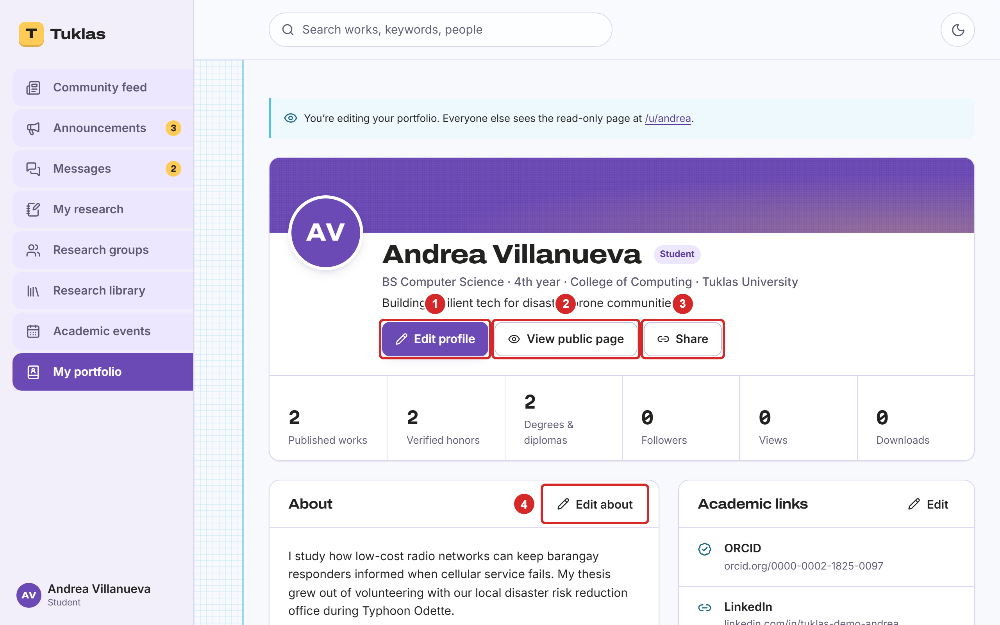

## Editing Your Profile

Select "Edit profile" at the top of your portfolio. Then:

1. Select "Choose photo" to add a photo (PNG, JPEG or WebP, up to 5 MB).
2. Correct your full name if needed.
3. Add titles, such as "PhD" or "MA", if you have any.
4. Enter your program or position, for example "BS Biology · 4th year".
5. Choose your department.
6. Write a short bio of one line. It appears under your name.
7. Write an extended bio for "About": your research interests, projects and goals. Leave a blank line between paragraphs.
8. Select "Save".

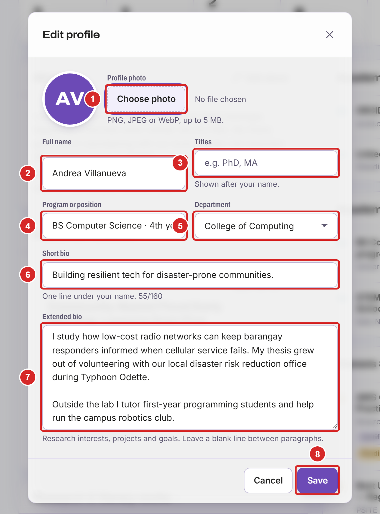

## Links, Background, Honors and CV

Further down your portfolio, each section has its own button:

1. "Edit" in "Academic links" adds or changes your pages on ORCID, Google Scholar, ResearchGate, LinkedIn or a faculty site.
2. "Add" in "Academic background" adds a degree or diploma, with the school and year.
3. "Add" in "Honors & awards" adds an award, grant or certification. An admin checks it before it shows as "Verified"; until then it says "Pending verification".
4. "Upload PDF" in "Curriculum vitae" adds your CV, which visitors can view and download.

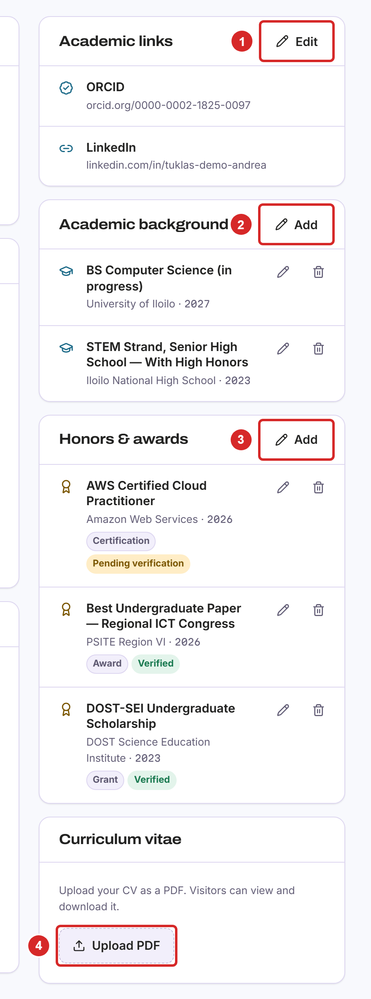

To change or remove an entry, select the pencil or bin button next to it.

## Your Works at a Glance

"My research" in the menu lists every work you have written or co-written, from draft to approval:

1. "New entry" starts a new work (section 4.5).
2. Each work shows its status: "Draft", "Submitted", "Under review", "Needs revision", "Approved" or "Rejected", and a line of steps from draft to approved and public.
3. "Open" shows the whole work.
4. "Edit draft" changes a work you haven't submitted yet.
5. "Reach" counts the views and downloads of your public works.

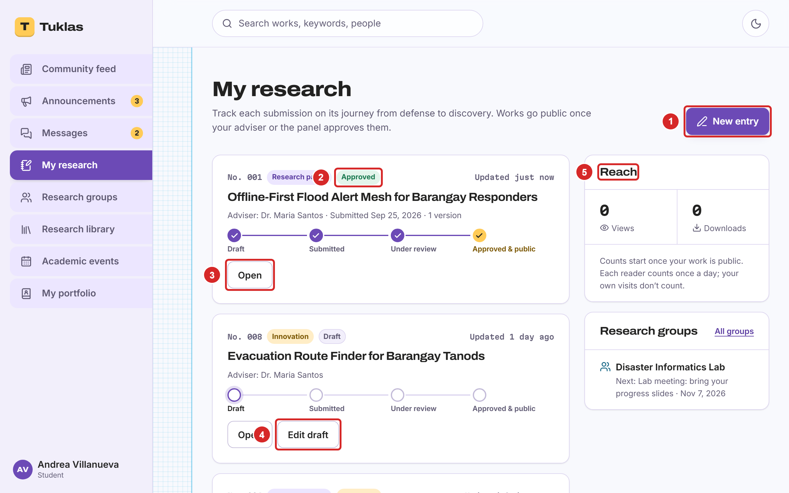

> **Note:** a work stays private until your research adviser or the academic panel approves it. Until then, only its authors, the adviser and the admins can see it.

## Starting a New Work

Select "New entry" on "My research". In the form that opens:

1. Choose the type: research paper, literary work or innovation.
2. Choose your research adviser.
3. Enter the title.
4. Enter keywords, separated by commas. Tuklas then lists similar approved works at your school, so you can check that your topic adds something new.
5. Write the abstract.
6. Optionally, write "How we made this": in your own words, how the idea started, what went wrong along the way, and what you'd tell the next student. Your panel reads it with the work, and its readers see it once the work is approved.
7. Choose who can read the work once it's approved: everyone, or only your school. You can change this later.
8. Add co-authors: type at least 2 letters of a name, then choose the person.

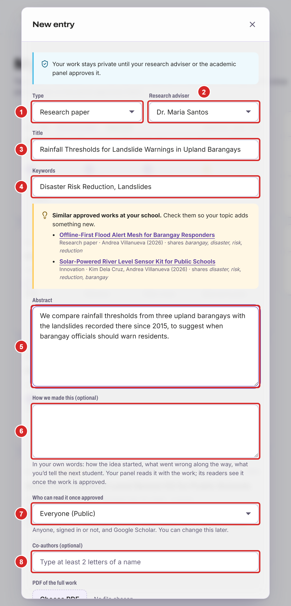

Scroll down to the end of the form:

1. Select "Choose PDF" to attach the full work (up to 20 MB). You can also add it later.
2. Select "Save draft" to keep working on it later,
3. or "Submit for adviser review" to send it to your adviser now.

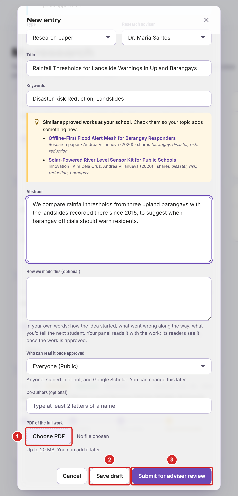

## Working on a Draft

Open a draft from "My research". At the top of the page:

1. "Edit entry" changes anything in the form.
2. "Submit for review" sends it to your adviser.
3. "Delete draft" removes it for good.

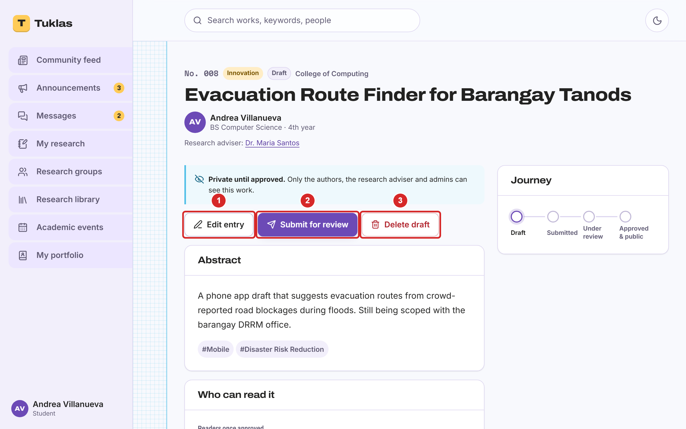

## Recording Defense Stages

Each work keeps a record of its defenses, under "Defense to Discovery":

1. Select "Add stage" to record a proposal defense, colloquium, final defense, revisions or publication, with its date, panel and verdict.
2. The pencil button changes a stage,
3. and the bin button removes it.

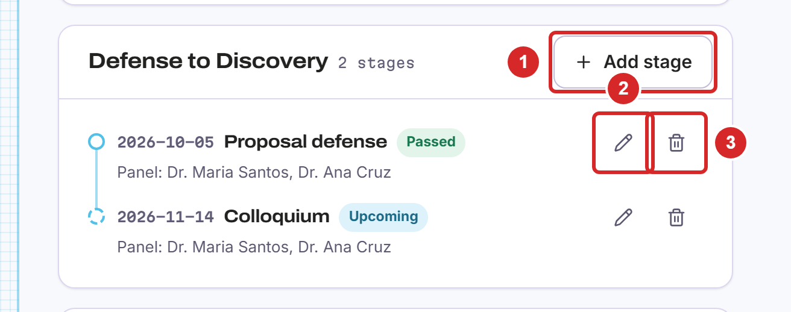

## When Your Adviser Asks for Revisions

When your adviser returns a work, its status becomes "Needs revision" and you get a notification. Open the work. Then:

1. Read "Review history": your adviser's comments, with a checklist of what to change.
2. Tick each item on the checklist as you finish it. It then shows "Done, awaiting adviser".
3. Ask your adviser a question in "Review thread", if you need to. Only you, your co-authors, your adviser and the admins see it.
4. Select "Revise & resubmit", make your changes and send the work again. Tuklas keeps each earlier version.

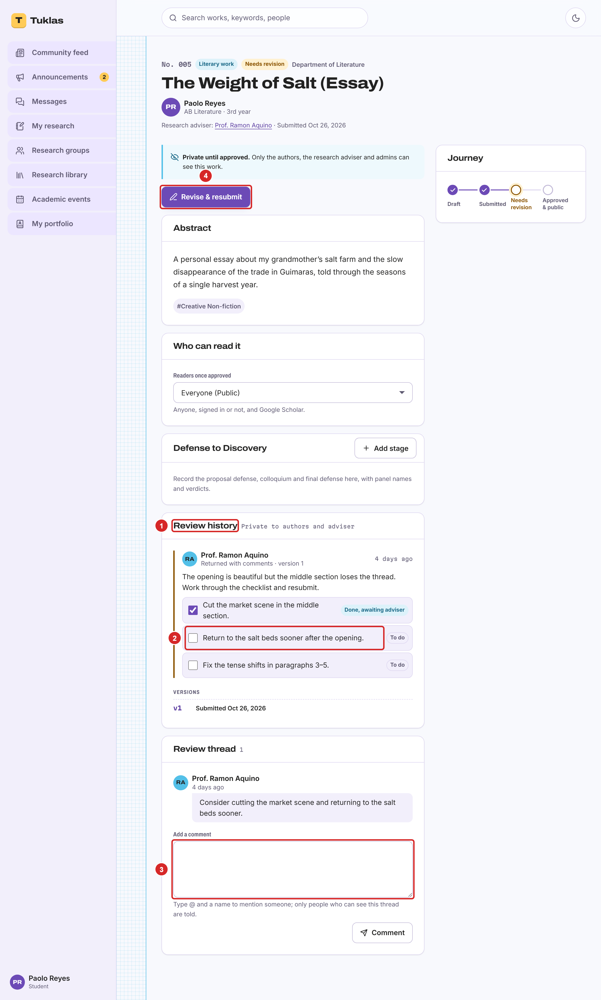

## Engaging with Others' Works

On a work that someone else wrote:

1. Write a comment in "Add to the discussion". Type @ and a name to mention someone; they get a notification.
2. Select "Comment" to post it.
3. React with "Insightful", "Useful" or "Inspiring".
4. "Save to library" keeps the work in your own list ("My library" in the feed).
5. "Share link" copies the work's address.
6. "Report" tells the admins about a problem with the work (section 4.10).

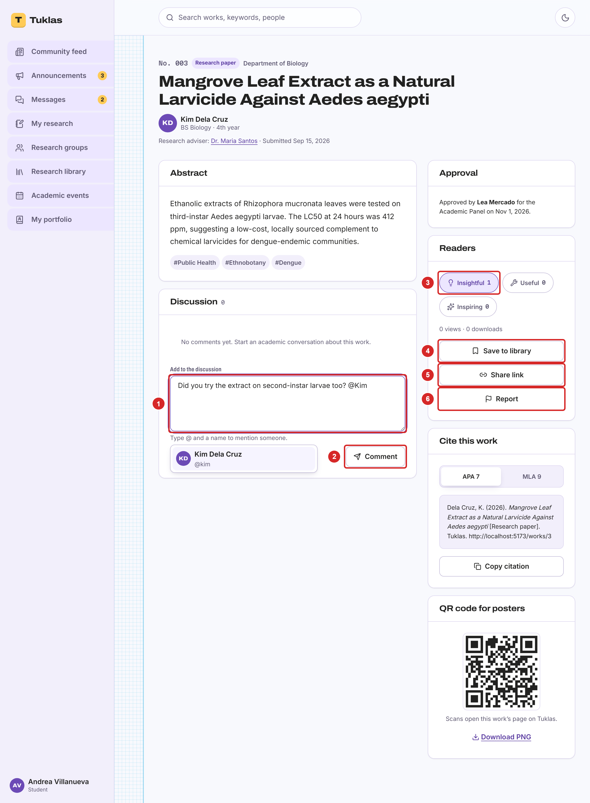

## Reporting a Problem

If a work, comment, message, event or person breaks the rules of an academic site, report it. Select "Report" next to it. Then:

1. Choose what's wrong: plagiarism, not appropriate for an academic site, harassment or bullying, spam or advertising, sharing someone's private information, or something else.
2. Optionally, add anything an admin should know.
3. Select "Send report".

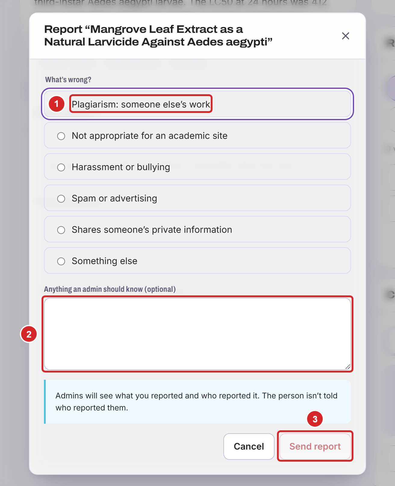

Admins see what you reported and who reported it. The person you reported isn't told who reported them.

## The Community Feed

"Community feed" shows approved works, opportunities and events from across your school:

1. Choose what to show: "All", "Research", "Literary works", "Innovations", "Opportunities" or "Events". At the end of the row, "My library" shows the works you saved and "Following" the work of people, departments and keywords you follow.
2. Narrow the feed by department, year, adviser or keyword.
3. Sort by "Newest" or "Most discussed".
4. "Save" keeps a work in your library.
5. "Read the work" opens it.

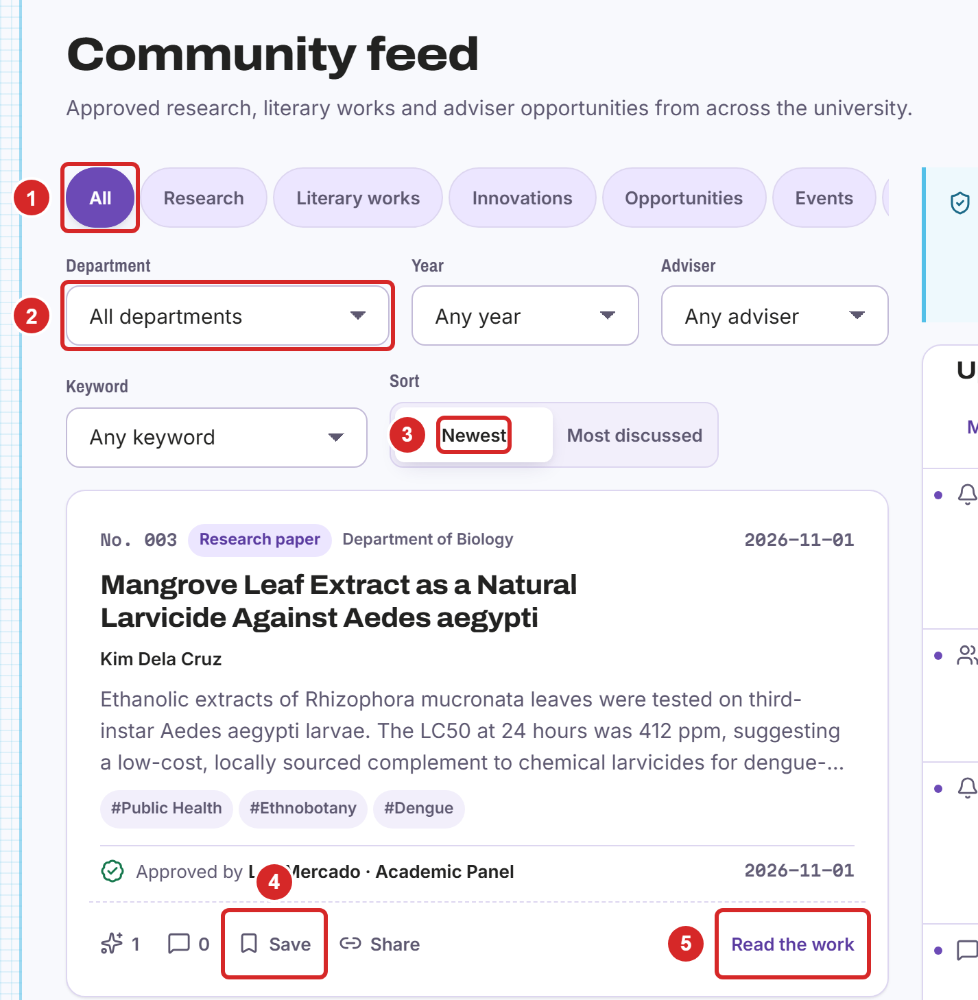

## Updates

"Updates", on the right of the feed, lists your notifications:

1. "Mark all read" clears the count of new updates.
2. Select an update to open what it's about.

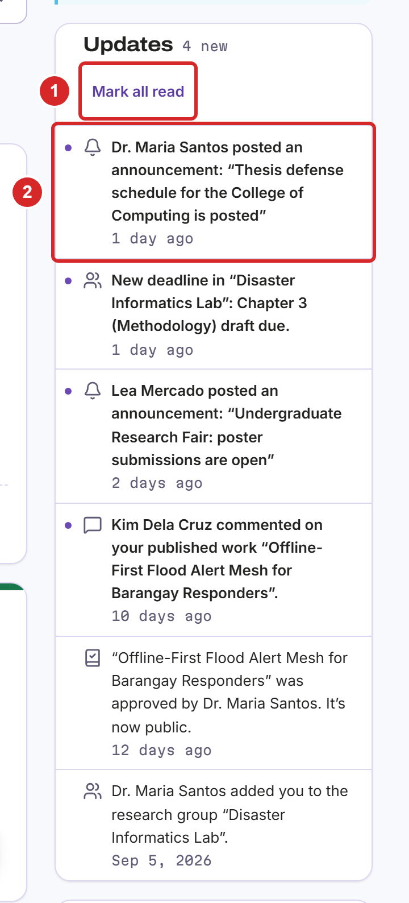

To choose which updates also reach you by email or on your phone, see section 2.13.

## Following People

Follow people whose work you want to see first:

1. On someone's portfolio, select "Follow". Their new works then appear under "Following" in the feed.

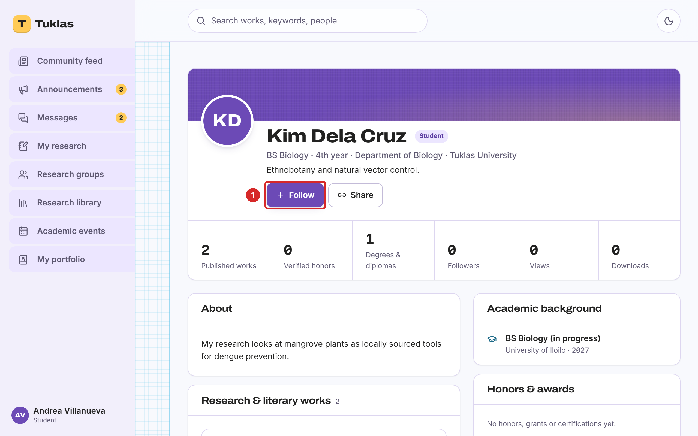

## The Research Library

"Research library" holds the research that educators publish, and leads to student works by department:

1. Search by title, keyword or author.
2. Narrow by year,
3. by department,
4. or by keyword.
5. "Browse by department" lists each department's publications and student works.

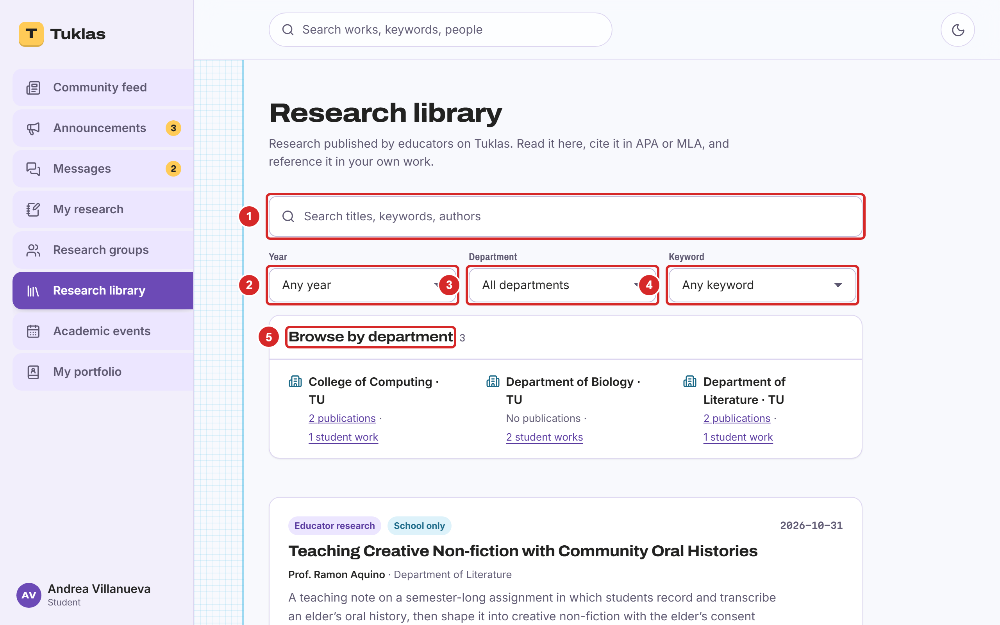

## Your Research Group

An educator adds you to a research group. Open it from "Research groups" in the menu:

1. "Chat" is the group's conversation. The other tabs hold its announcements, shared files, deadlines and recent activity.
2. Each channel is a separate topic. Select one to read it.
3. Write a message to the channel and press Enter.
4. "Send a file" shares a file in the channel.
5. "Members" lists the group's adviser, leader, members and mentors.
6. "Leave group" takes you out of the group.

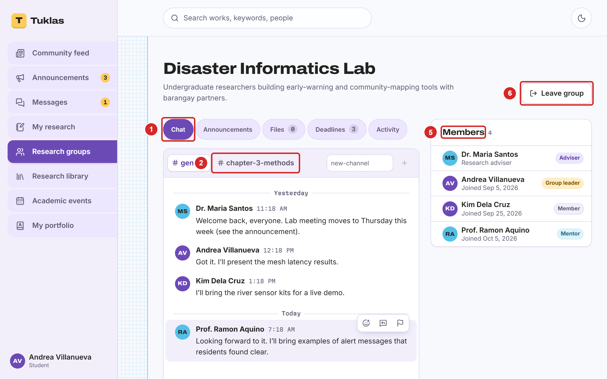

Group leaders can also add channels and deadlines.

## Handing In a Deliverable

Some deadlines collect work: each student hands in their own, or one person hands in for the whole group. Open the group's "Deadlines" tab and select the deadline. Then:

1. Your earlier hand-in is shown with its file, your note and your adviser's feedback.
2. Select "Choose file" to pick your file (a PDF, Word file, slides or any other file, up to 15 MB).
3. Optionally, add a note to your reviewers.
4. Select "Hand in", or "Hand in again" when your adviser asked for a revision.

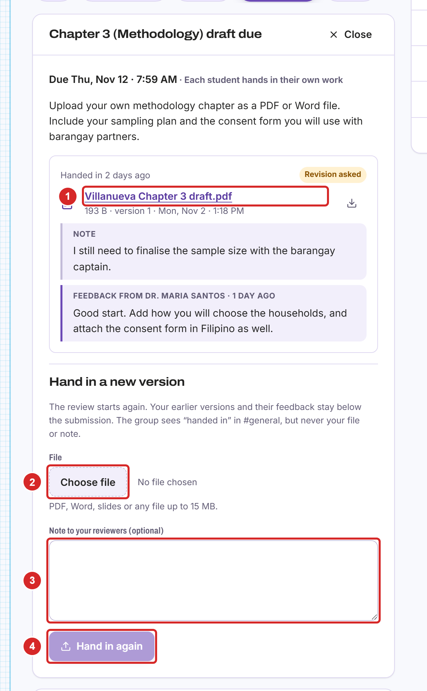

Your adviser then accepts it or asks for another revision, and you get a notification. Each version you hand in is kept with its feedback.

## Messages

"Messages" holds your direct messages and your groups' channels:

1. Find a chat by a person's, channel's or group's name. The buttons below filter the list to direct messages, channels or unread chats.
2. "New message" starts a chat with someone.
3. Point at a message to react to it,
4. or to reply in a thread. On your own messages you can also edit or remove them.
5. "Send a file" attaches a file.
6. Write your message here. Type @ and a name to mention someone.
7. Select "Send", or press Enter.

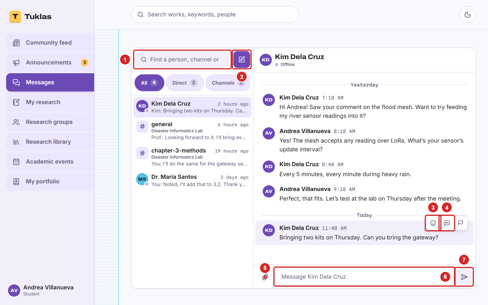

Under your own messages, "Seen by" shows who has read them.

> **Note:** messages are stored encrypted, so Tuklas can't search inside them. Find a chat by its name instead.

## Academic Events

"Academic events" lists the colloquiums, thesis defenses, research fairs, school innovations and the C.P. Garcia event:

1. Show one kind of event only.
2. Select an event's title to see its details.
3. Select "Register" to attend.
4. "Registered" shows that you're going. Select it again to cancel your registration.

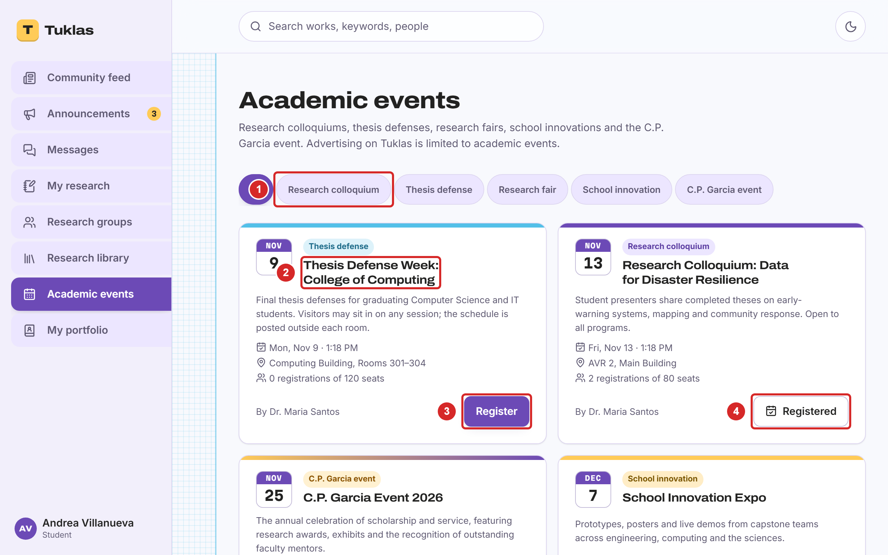

## Applying to an Opportunity

Educators post mentorships, grants and calls for papers. Choose "Opportunities" in the feed and select "Apply" on one. Then:

1. Write a message to the educator: why you're interested and what you'd bring. Your portfolio is linked automatically.
2. Select "Send application".

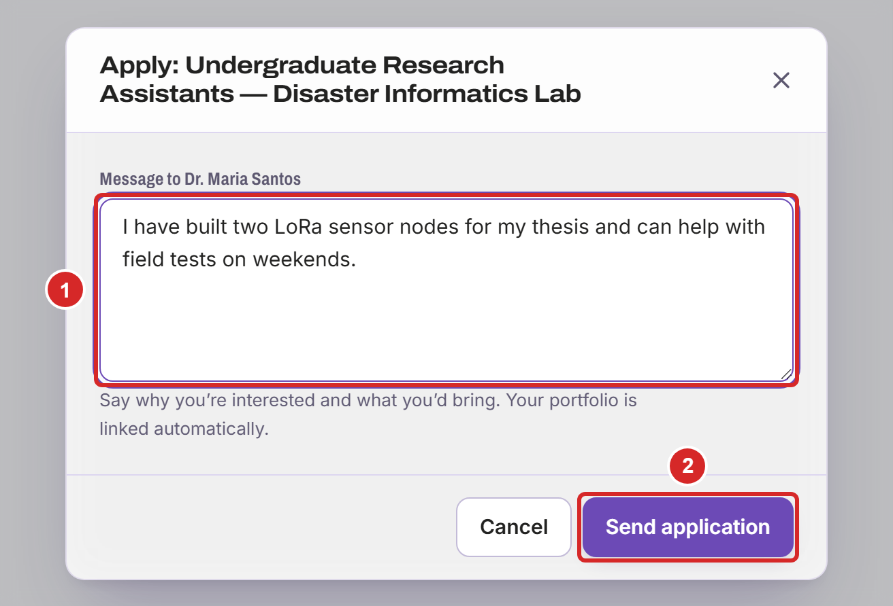

Once you've applied, the opportunity shows "Applied". Select "Withdraw" next to it to take back your application.

## Announcements

"Announcements" collects news from the research office, your department and your research groups:

1. "All" shows every announcement; the number counts the ones you haven't read.
2. Show only those for everyone, your school, your department or your groups.
3. Select an announcement to read it, with any attachments.

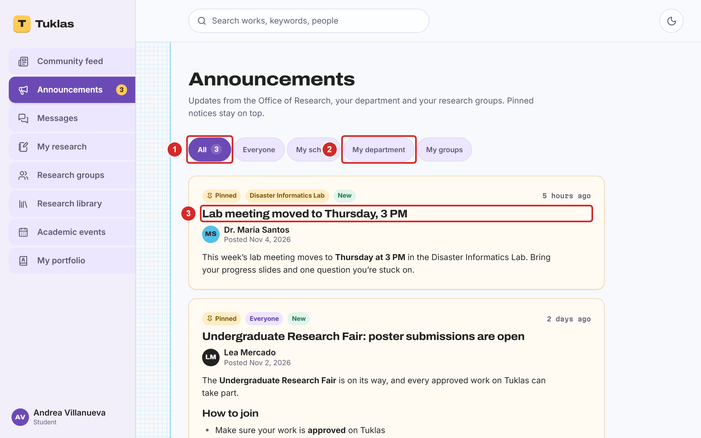
