# Educators

## What Educators Do

Educators can do everything students can (Chapter 4). In addition, they review their advisees' works, publish their own research, run research groups, and post opportunities, events and announcements. Their menu adds "Review board" and "Post opportunity".

Two rules apply to educators:

- **Verification.** After you sign up, an admin of your school checks that you are an educator. Until then you can't review works.
- **Rights.** An admin can switch three rights on or off for each educator: publishing research, moderating groups, and posting announcements. If a button described here is missing, ask your school's admin.

You must also use two-factor sign-in (section 2.6).

## The Review Board

"Review board" lists every work for which you are the research adviser, in four columns:

1. "Awaiting review": submitted works you haven't opened yet.
2. "Under review": works you have started reviewing.
3. "Needs revision": works you returned to their authors.
4. "Approved & signed": works you approved.

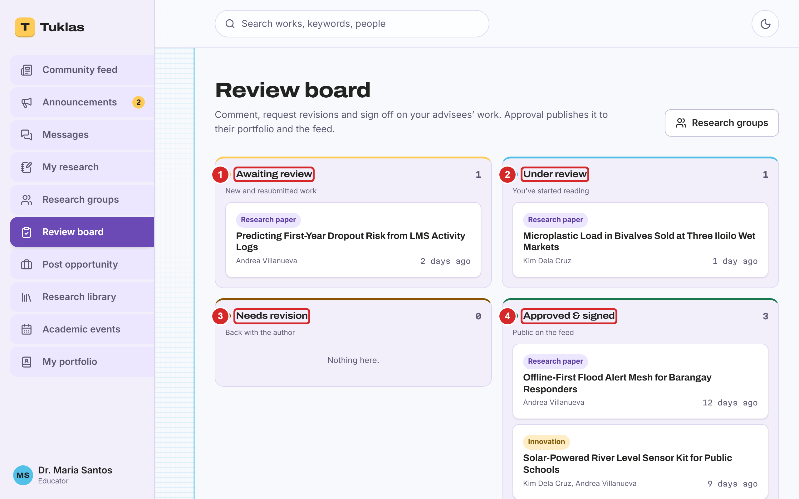

Select a work to open it.

## Deciding on a Work

On a submitted work, "Your decision" holds your choices:

1. "Start review" tells the authors that you are reading it.
2. "Approve & sign off" approves the work. It is published to the feed and to its authors' portfolios at once, with your name as the approver.
3. "Return with comments" sends it back for revision (section 5.4).
4. "Reject" marks it as not approved. Tuklas asks you to confirm, because this is final.

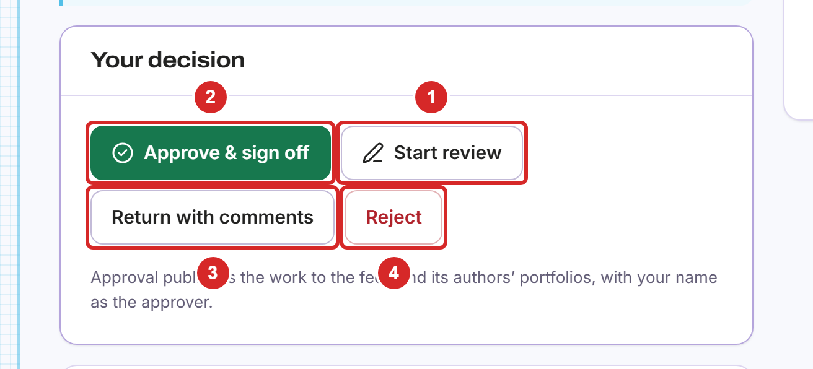

> **Note:** if a revision checklist item is still open, Tuklas asks you to confirm each fix before you can approve.

## Returning a Work with Comments

Select "Return with comments". Then:

1. Write your comments for the author.
2. List what must change, one fix per line. The author ticks each fix, and you confirm it before you can approve.
3. Select "Send to the author".

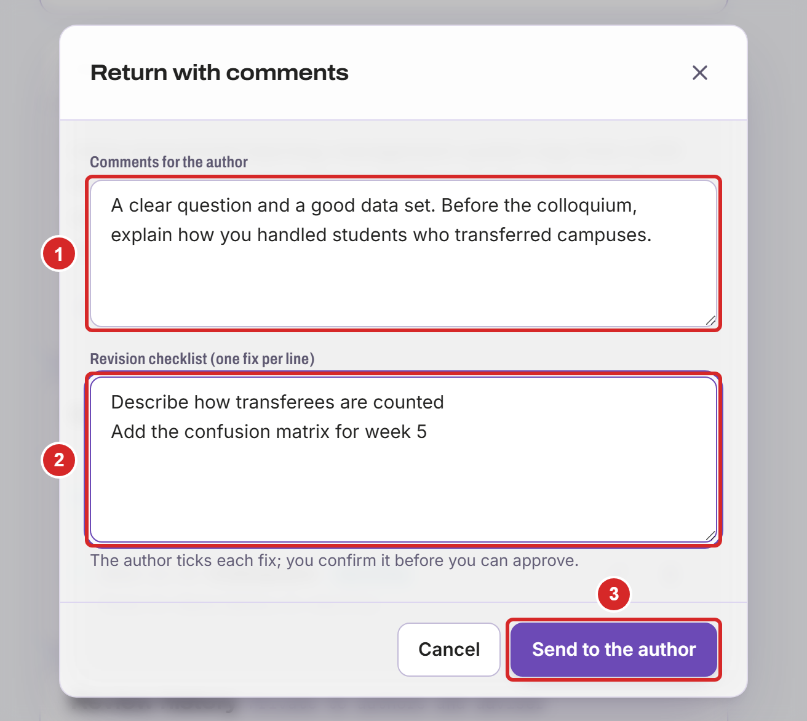

The author gets a notification. You can keep talking about the work in its "Review thread", which only the authors, the adviser and the admins see.

## Publishing Your Own Research

Your own papers appear in "My research" and the research library. Select "New research" on "My research". Then:

1. Enter the title.
2. Write the abstract.
3. Enter keywords, separated by commas.
4. Describe how the research was done: design, participants or data, instruments and analysis.
5. Select "Choose PDF" to attach the full text, if you have it.
6. Choose who can see it: "Draft" (only you and your co-authors), "School only" (people signed in from your school) or "Public" (anyone with the link, and your public portfolio).
7. Add co-authors: type at least 2 letters of a name, then choose the person.
8. Select "Save draft", or "Publish" when you chose "School only" or "Public".

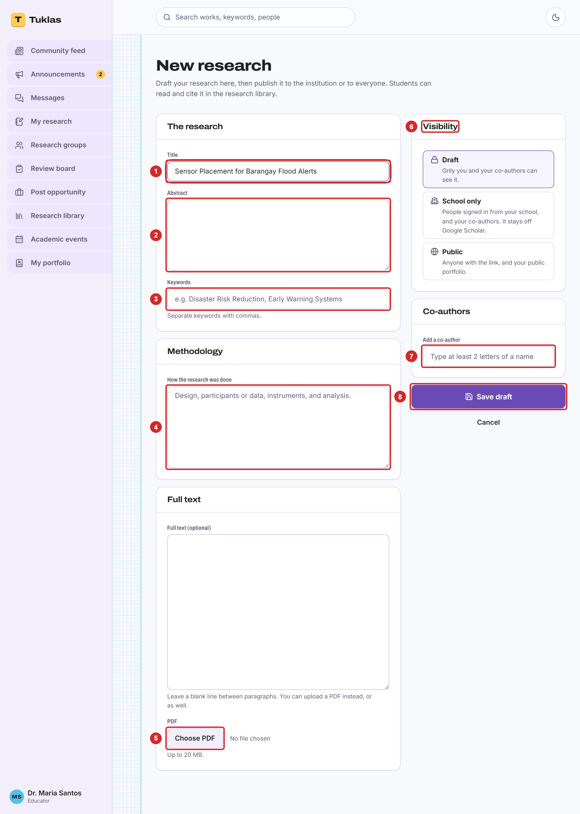

> **Note:** "School only" and "Public" need the publishing right. Without it, you can save drafts only.

## Starting a Research Group

Select "New group" on "Research groups". Then:

1. Enter the group's name.
2. Optionally, describe what the group works on.
3. Select "Create group". You become its research adviser.

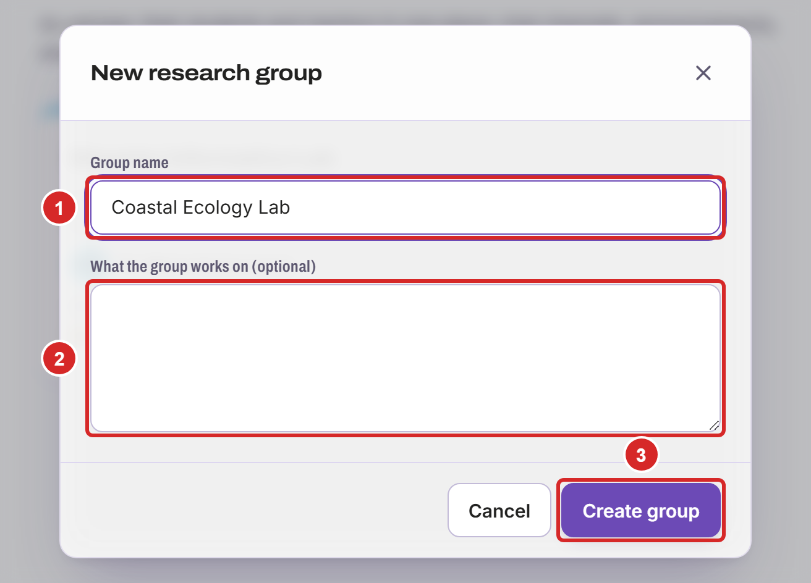

## Running a Research Group

On your group's page:

1. Add a member: type at least 2 letters of their name, then choose them.
2. Change a member's role: "Group leader", "Member" or "Mentor". Group leaders can add channels and deadlines too.
3. Remove a member from the group.
4. Add a channel: type its name, then select "Add channel".
5. "Delete group" removes the group for good.

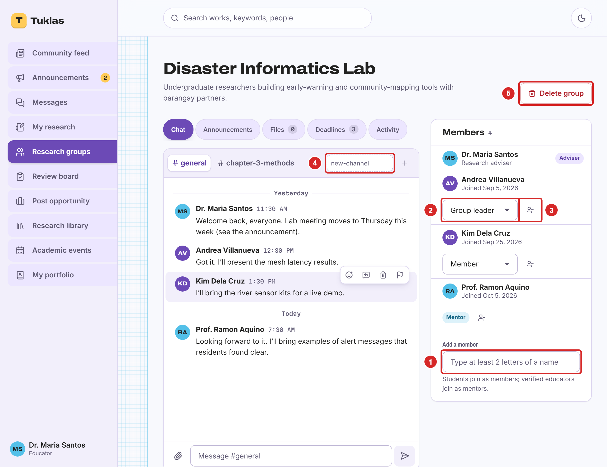

## Setting Deadlines

Open the group's "Deadlines" tab. Below the list of deadlines:

1. Enter what is due, for example "Chapter 2 draft".
2. Choose the due date.
3. Choose what students hand in: nothing (a reminder), their own work each, or one hand-in for the whole group. Add instructions if you want.
4. Select "Add".

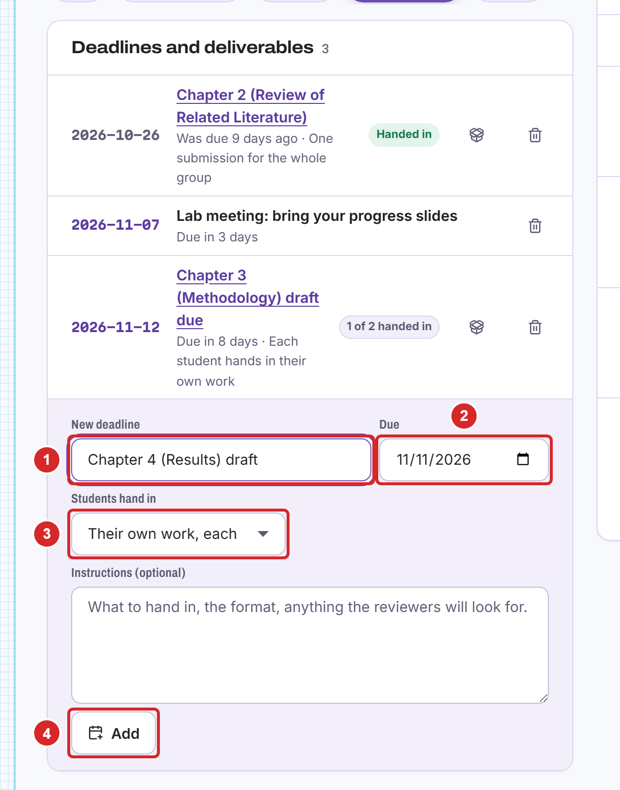

Everyone in the group gets a notification of the new deadline.

## Reviewing Deliverables

On the "Deadlines" tab, select a deadline that collects work. It shows who has handed in and who hasn't. For each hand-in:

1. Open the file the student handed in.
2. Write your feedback.
3. Select "Accept",
4. or "Ask for a revision". The student then hands in a new version.

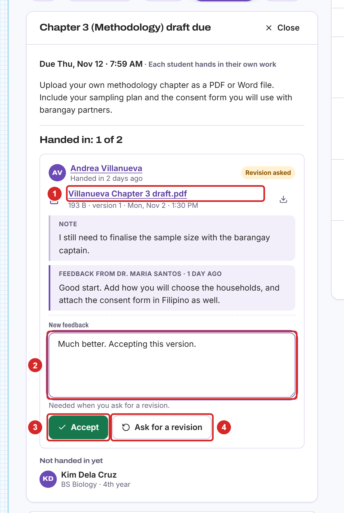

## Posting an Opportunity

Select "Post opportunity" in the menu. Under "New posting":

1. Choose the type: mentorship, grant or call for submissions.
2. Enter the title.
3. Describe who should apply, what they will do, and what they get.
4. Choose the application deadline.
5. Optionally, enter how many people you need.
6. Choose who can see it: your school, or every school on the site.
7. Select "Publish to feed".
8. "Your postings" lists your opportunities and the people who applied. Select a name to read their application and portfolio.

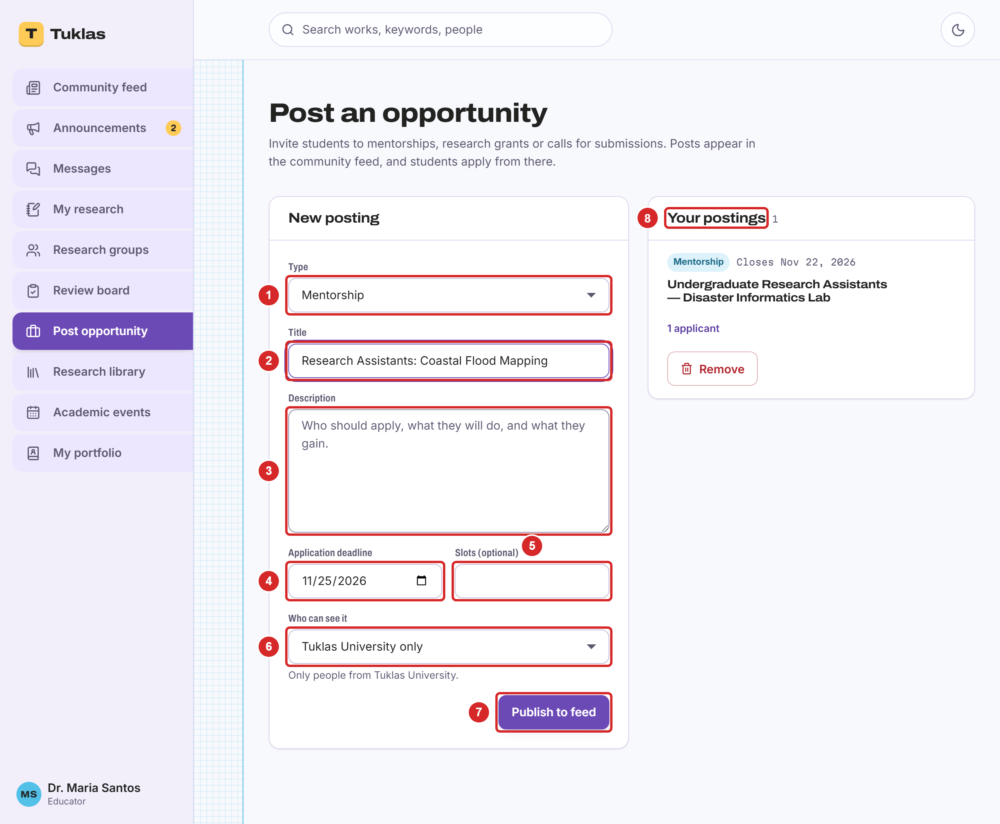

## Proposing an Event

Only academic events can be posted, and an admin reviews each one before it is listed. Select "Propose an event" on "Academic events". Then:

1. Choose the category: research colloquium, thesis defense, research fair, school innovation or the C.P. Garcia event.
2. Enter the event's title.
3. Choose the date and time.
4. Optionally, enter how many seats there are.
5. Enter the venue.
6. Choose who can see it: your school, or every school.
7. Describe the event.
8. Select "Submit for approval".

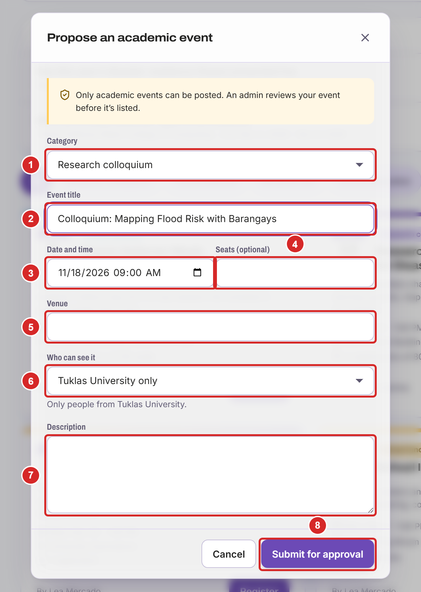

## Your Event's Page

Once your event is approved, open it from "Academic events":

1. "Attendees" lists the people who registered.
2. To promote the event in the feed's sidebar, enter a headline,
3. the first day to show it,
4. and the last day.
5. Optionally, select "Choose file" for an image.
6. Select "Request ad slot". An admin approves it first.
7. "Cancel event" cancels it. Registered attendees are told.

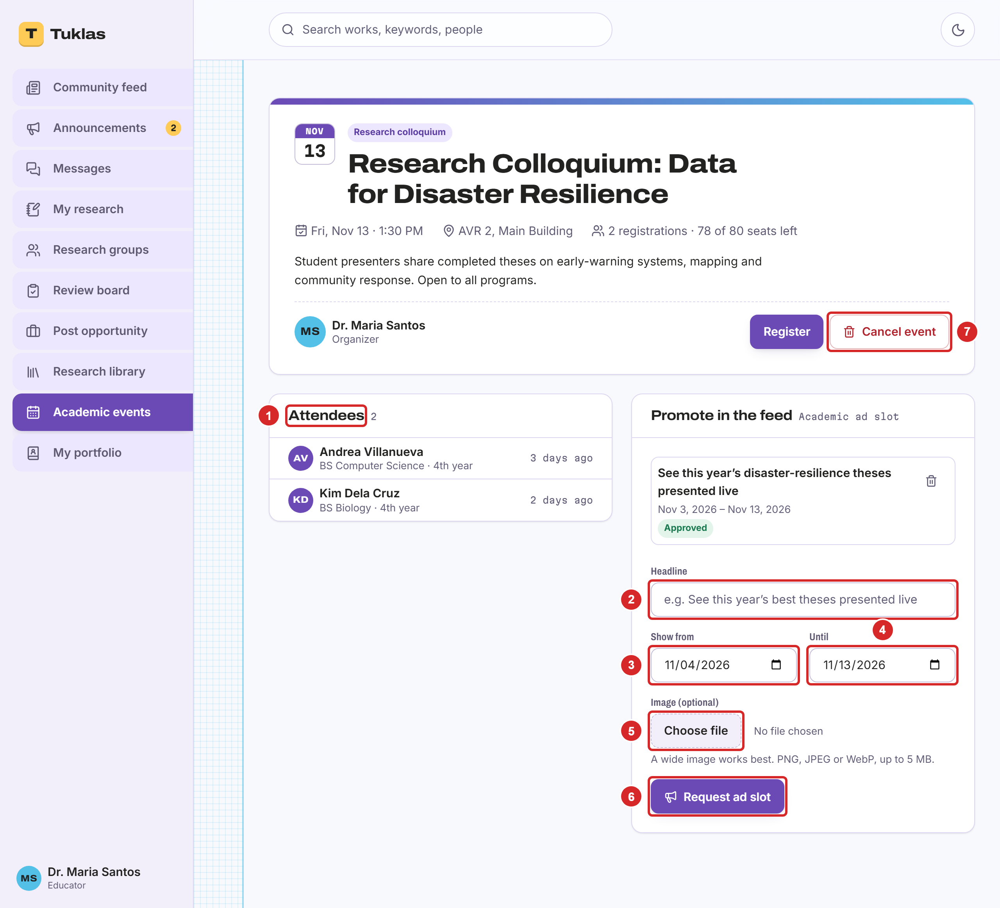

## Posting an Announcement

Select "New announcement" on "Announcements". Then:

1. Choose the audience: your department, or one of your groups.
2. Enter the title.
3. Write the announcement. The buttons above the text add bold, italics, headings, lists and links.
4. "Attach files" adds up to 5 files of up to 15 MB each.
5. Tick "Pin to the top of the feed" to keep it at the top.
6. Select "Post announcement". Everyone in the audience gets a notification and an email.

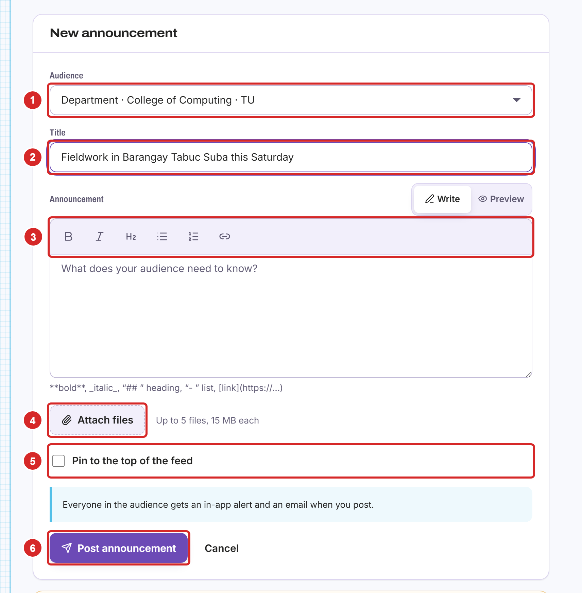

## Managing Your Announcements

On an announcement you posted:

1. "Seen by" shows who has read it.
2. "Pin" or "Unpin" keeps it at the top of the feed, or stops doing so.
3. "Edit" changes it.
4. "Delete" removes it.

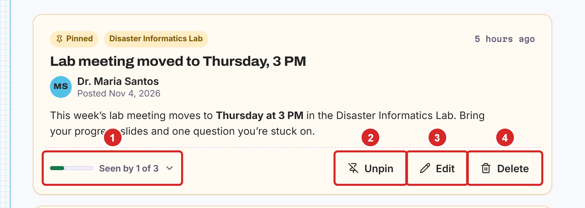
