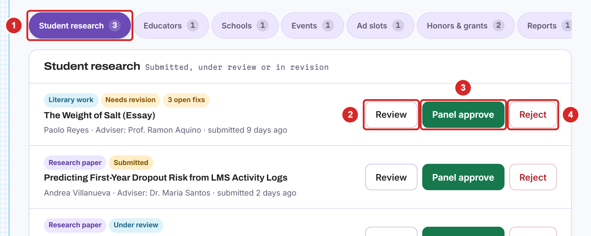
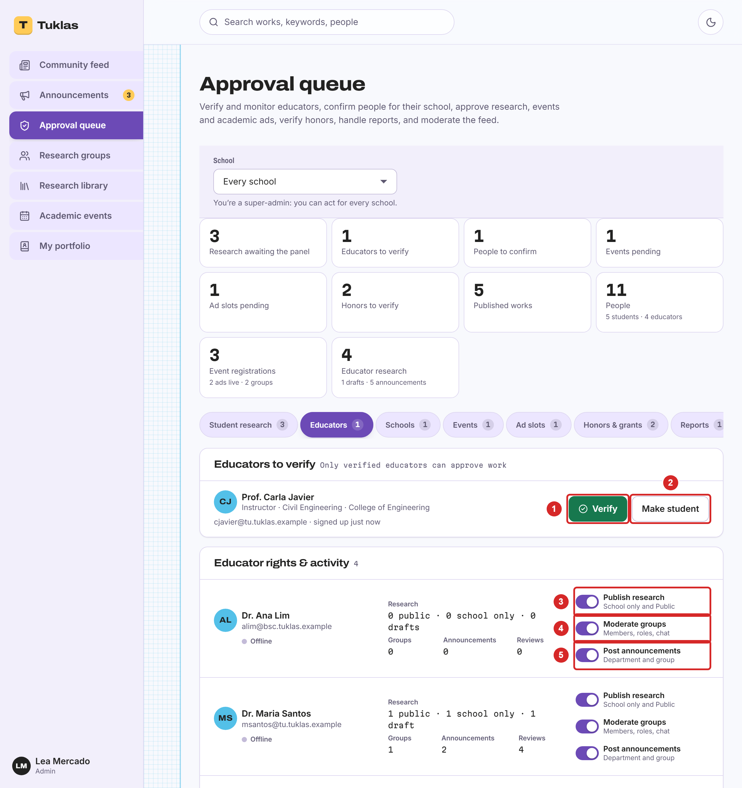
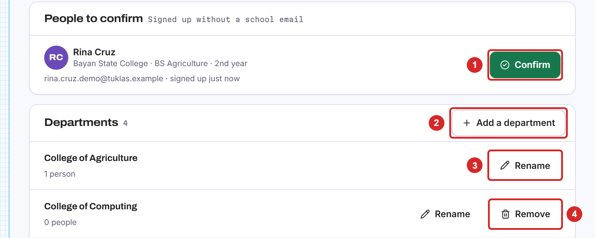
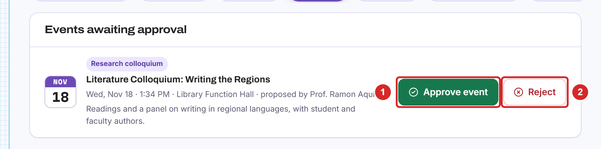
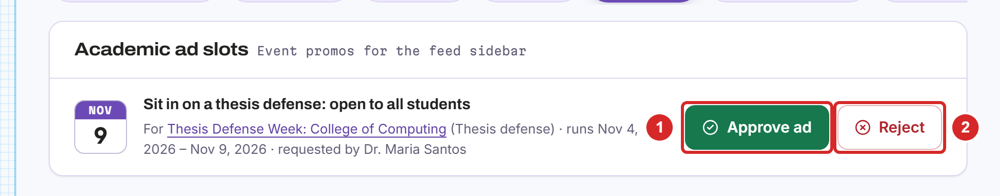
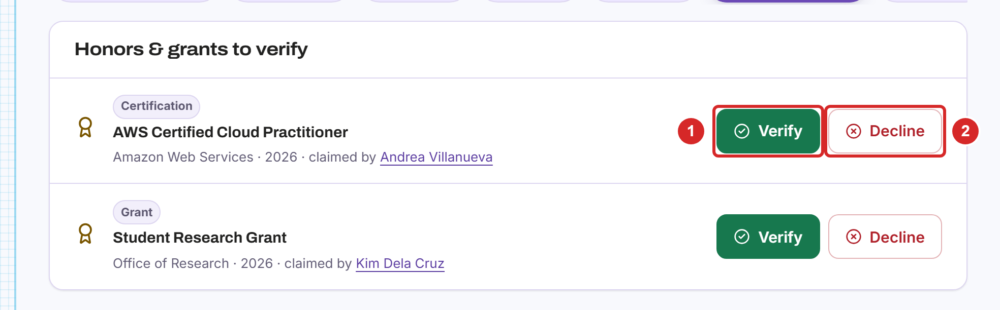
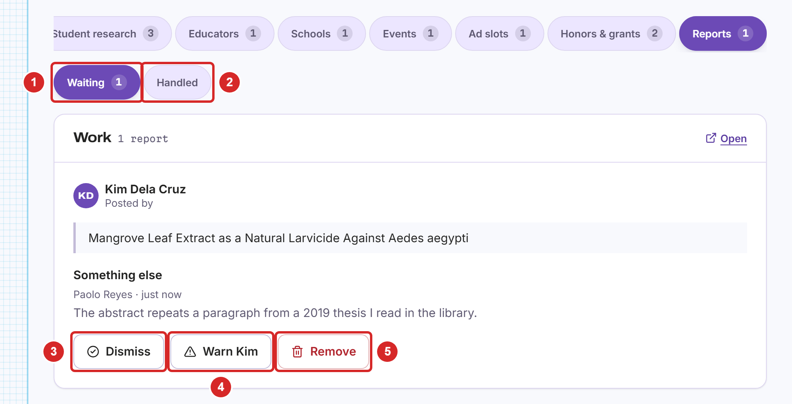
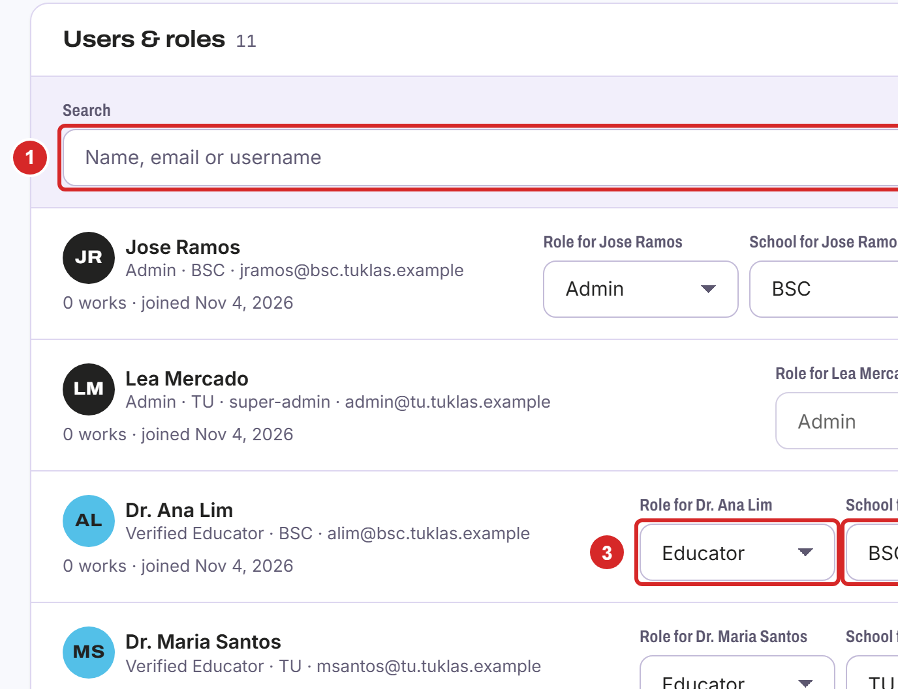
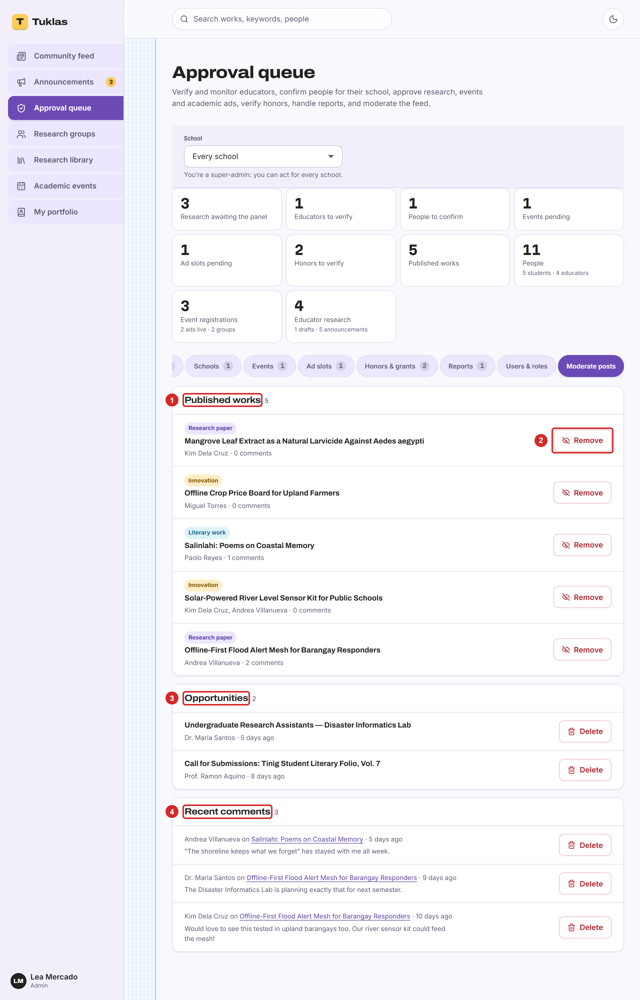

# Admins

## What Admins Do

Admins are the research office staff of a school. Their accounts are issued by the research office, never created by sign-up, and they must use two-factor sign-in. An admin acts only for their own school: its people, works, events and reports.

Admins work in "Approval queue" in the menu. Its tabs show how many items are waiting in each: student research, educators, schools, events, ad slots, honors and grants, and reports. "Users & roles" and "Moderate posts" are always there. Admins can also review works and post announcements to their whole school (section 5.13).

## Approving Student Research

Admins can approve works for the academic panel:

1. Open the "Student research" tab. It lists works that are submitted, under review or in revision.
2. "Review" opens a work to read it.
3. "Panel approve" approves it for the academic panel. It is published at once.
4. "Reject" marks it as not approved.

## Verifying Educators and Their Rights

Open the "Educators" tab:

1. "Verify" confirms that someone who signed up as an educator really is one.
2. "Make student" turns the account into a student account instead.
3. Switch the right to publish research ("School only" and "Public") on or off for each educator,
4. the right to moderate groups (members, roles and chat),
5. and the right to post announcements to a department or group.
6. "Recent educator activity" shows what educators have done lately: approvals, returns, publications, announcements and new groups.

## Confirming Sign-Ups and Departments

People who signed up without your school's email address wait for your confirmation (section 2.3). Open the "Schools" tab:

1. "Confirm" lets the person in. Check that they belong to your school first.
2. "Add a department" adds one to your school's list.
3. "Rename" changes a department's name,
4. and "Remove" takes it off the list.

## Approving Events

Open the "Events" tab. Check that each proposed event is academic, then:

1. Select "Approve event" to list it,
2. or "Reject".

## Approving Ad Slots

Educators ask to promote their events in the feed's sidebar. Open the "Ad slots" tab:

1. Select "Approve ad" to show it,
2. or "Reject". Ads are for academic events only, never commercial content.

## Verifying Honors and Grants

Members add their awards, grants and certifications to their portfolios. Open the "Honors & grants" tab and check each claim. Then:

1. Select "Verify" to mark it "Verified" on the portfolio,
2. or "Decline".

## Handling Reports

Members report works, comments, messages, events and people (section 4.10). Open the "Reports" tab:

1. "Waiting" lists the reports to handle,
2. and "Handled" the ones already decided.
3. "Dismiss" closes a report that needs no action.
4. "Warn" sends the owner of the content a warning.
5. "Remove" takes the content down.

The person who reported gets a notification of the outcome. The person reported isn't told who reported them.

## Users and Roles

Open the "Users & roles" tab:

1. Search for people by name, email or username,
2. or show one role only.
3. Change a person's role: student, educator or admin.
4. Super-admins can also move a person to another school. Tuklas asks to confirm first.
5. "Verify" or "Unverify" an educator.

## Moderating Posts

Open the "Moderate posts" tab:

1. "Published works" lists the approved works.
2. "Remove" takes a work off the site, for example after a report of plagiarism. It can be restored later.
3. "Opportunities" lists the posted opportunities, which you can delete.
4. "Recent comments" lists the latest comments, which you can delete.

Admins can also delete any chat message and manage any research group.
