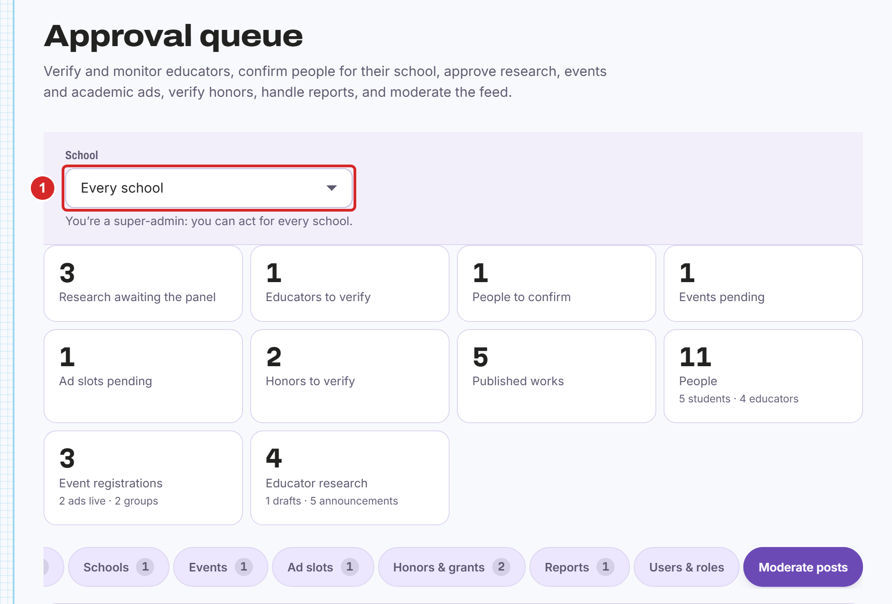
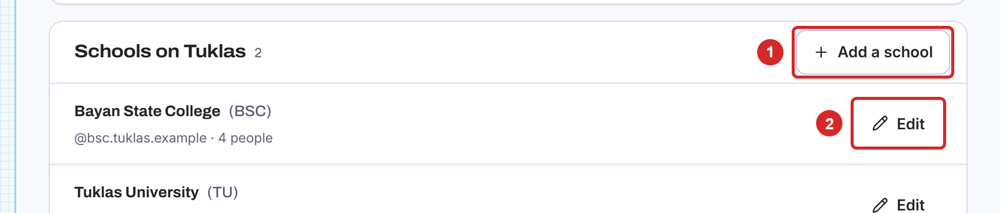
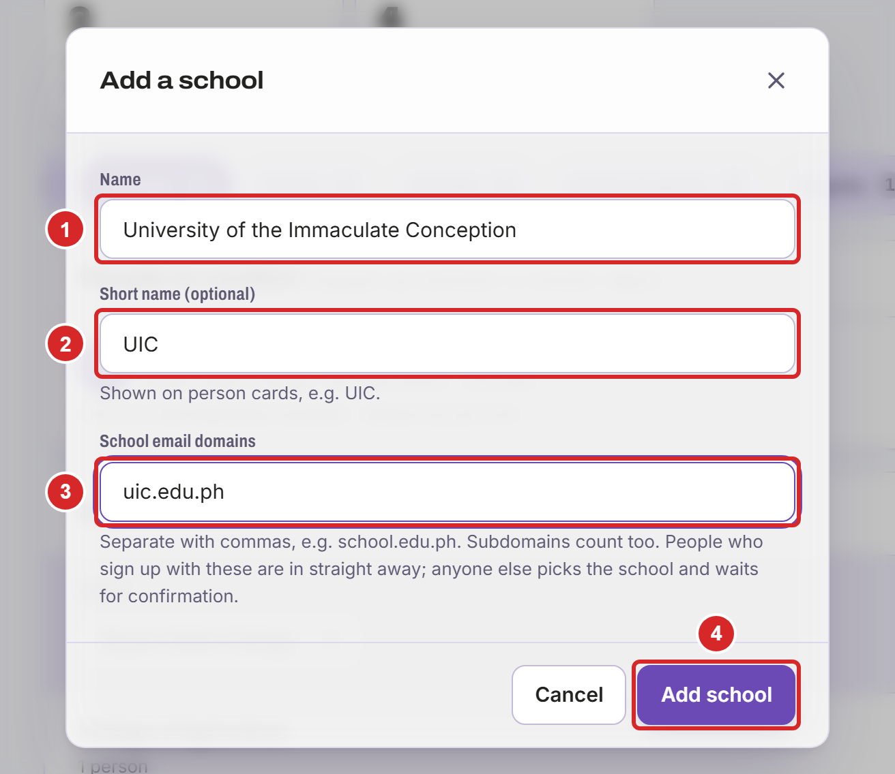
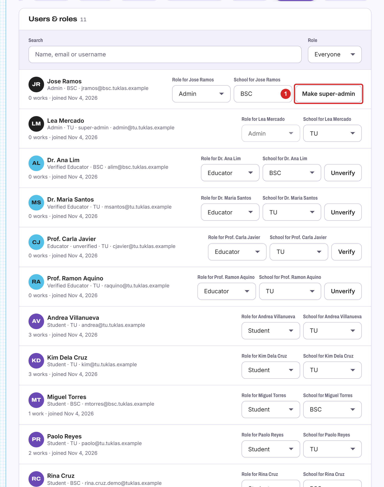

# Super-Admins

## What Super-Admins Do

Super-admins are admins who act for every school on the site: the project team and one university contact. They can do everything in Chapter 6, for any school, and they manage the schools themselves. The first super-admins are created on the server by the people who run it.

## Working Across Schools

At the top of "Approval queue", super-admins choose which school to work on:

1. Under "School", choose one school, or "Every school" to see everything waiting across the site.

## The Schools on the Site

Open the "Schools" tab and scroll to "Schools on Tuklas":

1. "Add a school" adds a new one (section 7.4).
2. "Edit" changes a school's name, short name or email domains.

## Adding a School

Select "Add a school". Then:

1. Enter the school's full name.
2. Optionally, enter a short name, such as "UIC". It's shown on person cards.
3. Enter the school's email domains, separated by commas, for example "uic.edu.ph". Subdomains count too. People who sign up with these addresses are in straight away; anyone else picks the school and waits for its admins to confirm them.
4. Select "Add school".

Then give the school its own admin (section 7.5), who adds its departments (section 6.4).

## Making an Admin or Super-Admin

Open the "Users & roles" tab and find the person:

1. To make an admin, change their role to admin and choose their school (section 6.9). To let an admin act for every school, select "Make super-admin".

> **Note:** keep at least two super-admins, so access isn't lost if one leaves.
