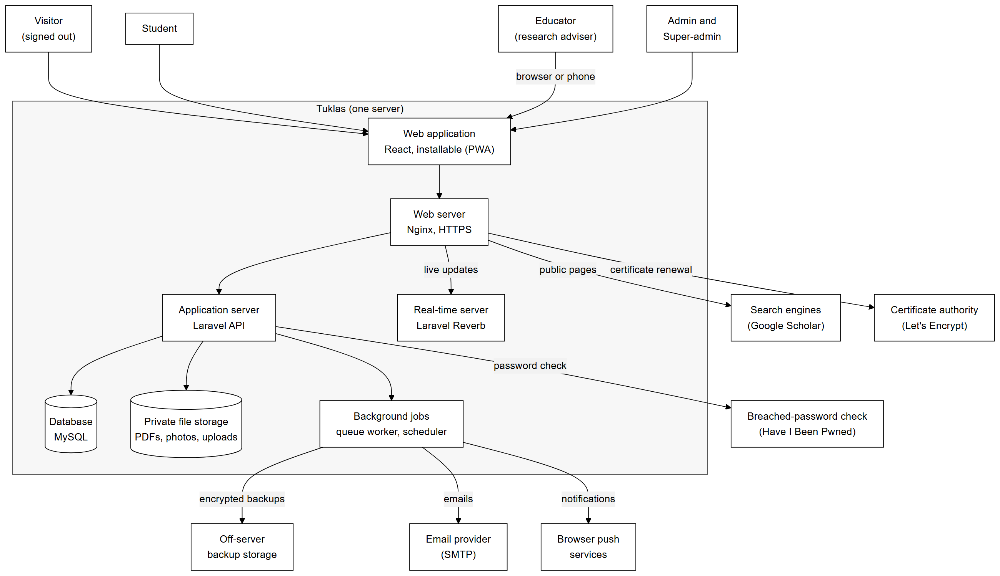

# 2. Overall Description

## Product Perspective

Tuklas is a new, self-contained product. It is not part of a larger system and replaces no existing university system. It grew out of two earlier stages of the same project: a single-file prototype that showed the screens with demo data (Reference 4), and a first server written in Node.js and Express. In October 2026 the team rewrote that server as a Laravel application and kept the React user interface.

Release 1.0 does not connect to a university's existing systems, such as student records, a learning management system or single sign-on. People sign up with their school email address, and its domain places them in their school. People without a school address choose their school and wait for its administrators to confirm them.

Figure 1 shows the major components of Tuklas and the outside systems it works with. Everything inside the box runs on one server:

- **Web application.** The user interface, written in React. The server sends it to the browser, where it runs. It can be installed on a phone or computer as a progressive web app.
- **Web server (Nginx).** It accepts every connection over HTTPS and passes each request to the right part of the system.
- **Application server (Laravel).** It holds every business rule: who may see, create, change or approve what. The web application talks to it through a JSON API.
- **Real-time server (Laravel Reverb).** It tells open browsers that something has changed, such as a new message or notification, so the screen updates without a reload.
- **Background jobs.** A queue worker sends emails and push notifications without making the user wait. Scheduled tasks send the weekly digest and run the nightly backup.
- **Database (MySQL) and private file storage.** They hold the system's data and uploaded files. Uploaded files are never served directly; the application server checks access to each one.

Outside the server, Tuklas uses an email provider to deliver its emails, the browsers' push services to deliver phone notifications, and a breached-password service to check new passwords. It sends nightly backups, encrypted first, to storage on another site. Search engines such as Google Scholar read its public pages. A certificate authority issues its HTTPS certificate. Educators and administrators also use an authenticator app on their phones for two-factor sign-in; the app has no connection to Tuklas.

## Product Functions

Tuklas lets its users do the following. Section 4 describes each group in detail.

- **Accounts, sign-in and privacy:** sign up with consent to the privacy notice, verify the email address, sign in with optional or required two-factor sign-in, reset a password, manage sessions, export one's data and delete one's account.
- **Portfolios:** a public portfolio for each member, with research and literary works first, then academic background, then honors and awards, plus academic links, a photo and a CV.
- **Works and adviser review:** students draft research, literary and innovation works with a PDF, choose an adviser and submit them. The adviser reviews, asks for revisions, approves or rejects them, and records defense stages. Only approved works become public.
- **Educator publications:** educators publish their own research as a draft, for their school only, or publicly.
- **Discovery:** a community feed, a library for browsing by year, department, adviser, type and tag, search, reactions, comments, saved works, citations, follows, and view and download counts.
- **Research groups and deliverables:** educators run groups with members, channels, shared files and deadlines. Students hand in deliverables, and advisers accept them or ask for revisions.
- **Chat:** direct messages and group channels with files, replies, mentions, reactions, edits and read receipts.
- **Events, ads and opportunities:** educators post academic events, event ads, mentorships, grants and calls for papers, which an administrator approves. Members register and apply.
- **Announcements:** system, department and group announcements with attachments and read receipts.
- **Notifications:** in-app, live, email and push notifications, chosen per kind by each member, and an optional weekly digest.
- **Reports and moderation:** members report content or people; administrators review the reports and remove, restore or warn.
- **Administration and schools:** administrators verify educators and their rights, confirm sign-ups, approve honors, events and ads, and see statistics. Super-admins manage the schools on the site.

## User Classes and Characteristics

Tuklas has five user classes. The **Student** and **Educator** classes are the most important to satisfy, because the main workflow, from a student's submission to an adviser's approval, runs between them.

| User class | Who they are | Characteristics and privileges |
|---|---|---|
| Visitor | Anyone who isn't signed in: academic peers from other institutions, hiring committees, the public, search engines | Occasional use, any level of technical skill. Reads public portfolios, approved public works and their PDFs, and public publications. May sign up. |
| Student | Undergraduate and graduate students of a school on the site | The largest and most frequent group, mostly on phones. Builds a portfolio, submits works, engages with others' work, joins research groups, chats. Two-factor sign-in is optional. |
| Educator | Faculty who advise research, called research advisers on review screens | Signs up as an educator and must be verified by an administrator of their school before reviewing. Has every Student function, plus reviewing advisees' works, publishing their own research, running groups and posting events and opportunities. An administrator can switch three rights on or off per educator: publish, moderate groups and broadcast announcements. Two-factor sign-in is required. |
| Admin | A school's research office staff | Issued by the system's operators, never self-created. Acts only within their own school: verifies educators, confirms sign-ups, manages the school's departments, approves honors, events and ads, moderates content and posts announcements. Two-factor sign-in is required. |
| Super-admin | The project team and one university contact | An Admin who acts for every school on the site and manages the schools themselves: their names and email domains. Two-factor sign-in is required. |

## Operating Environment

**Users' devices.** Tuklas runs in the current versions of Google Chrome, Microsoft Edge, Mozilla Firefox and Apple Safari, on Windows, macOS, Android and iOS, with JavaScript and cookies enabled. Its layout adapts from phone screens to desktop monitors. It can be installed as a progressive web app on Android, iOS and desktop computers. Push notifications work in browsers that support the Web Push standard; on iPhones and iPads they need Tuklas to be installed to the home screen.

**Server.** The server software is:

- Ubuntu 24.04 LTS as the operating system
- Nginx as the web server, with a Let's Encrypt certificate for HTTPS
- PHP 8.4 (PHP-FPM) running Laravel 13
- MySQL 8.4 LTS as the database
- Laravel Reverb for real-time updates, and a queue worker, both kept running by Supervisor
- cron for scheduled tasks and the nightly backup
- Node.js 22, used only to build the web application during a release

The server runs nothing else. Release 1.0 runs on a Microsoft Azure for Students virtual machine of size Standard_B2ats_v2 (2 virtual CPUs, 1 GB of memory, a 64 GB SSD) in the Japan East region. The long-term production host is TBD-1.

**Development.** Developers work on Windows or macOS with PHP 8.3 or later and Node.js 22, using SQLite or MySQL locally. Automated tests run on every change in GitHub Actions.

## Design and Implementation Constraints

- **Data privacy law.** The system handles personal data of students and faculty and must comply with the Data Privacy Act of 2012 (RA 10173): consent to a privacy notice at sign-up, access to and export of one's own data, deletion of one's account, and protection of the data stored. Each school needs a Data Protection Officer and a data processing agreement (TBD-6).
- **Security standards.** The system follows OWASP ASVS 4.0.3 at Level 2, avoids the OWASP Top 10 risks, and follows NIST SP 800-63B for passwords and two-factor sign-in.
- **Client rules.** A student's work is public only after adviser or panel approval, and advertisements are limited to academic events. Both rules are enforced on the server, never only in the user interface.
- **Technology.** The server is a Laravel 13 application (PHP 8.3 or later) that offers a JSON API; the user interface is a React 19 application written in TypeScript and built with Vite. Sign-in uses session cookies with CSRF protection (Laravel Fortify and Sanctum). The site, its API and its real-time connection share one domain.
- **Encryption at rest.** Chat messages, comments, review comments and deliverable feedback are stored encrypted. As a result, the server cannot search inside chat messages. Members find a chat by the person's, channel's or group's name instead, and filter the list to direct messages, channels or unread chats.
- **Budget.** Release 1.0 runs on free services: a server with 1 GB of memory, an email plan that sends up to 300 emails a day, and a domain that is free for its first year. Uploaded files are limited to 20 MB each.
- **Language.** The user interface is in English.
- **Programming standards.** The code follows Laravel's conventions. Database columns are in snake_case and API fields in camelCase. Every access rule lives in a policy, and anything a person may not see answers "not found". The PHP code is formatted with Laravel Pint and checked with Larastan at level 5. Every change in behavior comes with an automated test, and the database changes only through new migrations.
- **Schedule and team.** The first release was due in the first week of November 2026, with progress reviews with the client every two weeks. A small team of student developers builds it in parallel, one planned branch per task.

## User Documentation

The following documentation is delivered with release 1.0:

- **In the application:** the privacy notice, and step-by-step guidance on the screens that need it, such as setting up two-factor sign-in.
- **For the people who run the server:** the staging server guide (docs/STAGING_SERVER.md), the production runbook (docs/PRODUCTION_SERVER.md), and the server setup, release, backup and restore guide (tuklas/deploy/README.md).
- **For developers:** the setup guide (docs/GETTING_STARTED.md), the architecture (docs/ARCHITECTURE.md), the coding conventions (docs/CONVENTIONS.md) and the team workflow (docs/COLLABORATION.md).
- **This SRS**, in Microsoft Word format.

All the guides above are Markdown files in the source code repository. A user manual for Students, Educators and Admins is TBD-4.

## Assumptions and Dependencies

**Assumptions.** The requirements assume the following:

- Each school on the site provides its name, its email domains, its departments and a first administrator.
- Members have a modern browser and an internet connection. Educators and administrators have a phone with an authenticator app.
- One site serves hundreds to a few thousand users, so one server is enough.
- The client approves the final privacy notice (TBD-5), and each school signs a data processing agreement (TBD-6).
- The free services named in 2.5 stay available for release 1.0.

**Dependencies.** The project depends on:

- **Third-party software:** the Laravel framework with Fortify, Sanctum and Reverb; the minishlink/web-push library for push notifications; React, TanStack Query and Vite for the user interface.
- **An email provider** that relays email over SMTP (TBD-3).
- **The Have I Been Pwned password service**, which tells the server whether a new password has appeared in a known data breach. Only the first five characters of the password's hash leave the server. If the service can't be reached, the check is skipped.
- **The browsers' push services** (from Google, Apple and Mozilla), which deliver push notifications.
- **Let's Encrypt** for the HTTPS certificate, and **GitHub** for the source code and the automated tests.
