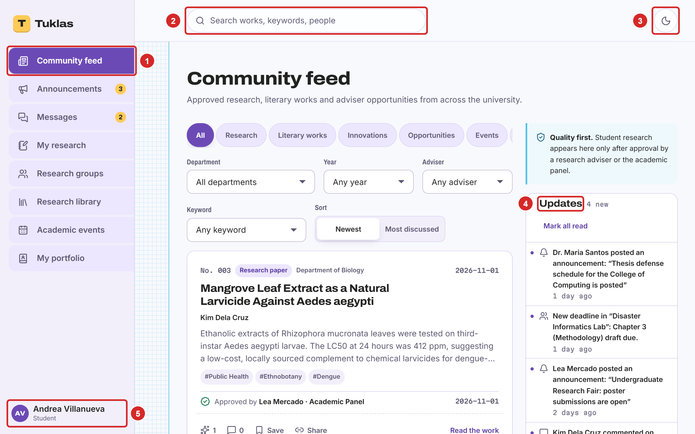

# 3. External Interface Requirements

## User Interfaces

Tuklas has one user interface: a web application that runs in the browser and can be installed as a progressive web app. Visitors see a plain frame with the Tuklas logo and a "Log in" button; signed-in members see the full layout in Figure 2. Every screen follows the same layout, so that a member who learns one screen can use the others:

- **Menu.** On a computer, a menu on the left lists the parts of Tuklas that the member's role may use (box 1 in Figure 2). On a phone, a bar at the bottom holds the main items and "More" opens the rest. Counters on "Announcements" and "Messages" show what is unread.
- **Search** (box 2) at the top of every screen finds works, keywords and people.
- **Light and dark mode** (box 3), and the member's menu (box 5) with the appearance settings, "Account and security" and "Log out".
- **Updates** (box 4): the member's notifications, beside the feed.

The interface shall meet these requirements:

- **Appearance.** The interface offers two looks, "Modern" and "Classic" (inspired by early academic networking sites, at the client's request), each in light or dark mode, or following the device's setting. The identity is the purple and gold palette and the tagline "From Defense to Discovery" agreed on 1 October 2026 (Reference 2). The choice is kept on the device.
- **Screen sizes.** Every screen adapts from a phone to a desktop monitor.
- **Content order.** Portfolios show research and literary works first, then academic background, then honors and awards (client requirement, Reference 1).
- **Labels and language.** All text is in plain English. Buttons say what they do ("Submit for adviser review", "Hand in again"), and destructive actions ask for confirmation.
- **Messages to the user.** A short message appears at the bottom of the screen after an action succeeds or fails. Errors in a form appear next to the field they concern, in words the member can act on, and never show technical details.
- **Setup screens.** A member who hasn't finished setting up the account sees one screen at a time until it is done: confirming the email, setting up two-factor sign-in (Educators and Admins), waiting for the school's confirmation, and accepting the privacy notice.
- **Accessibility.** The interface follows common accessibility practice: controls carry text labels for screen readers, forms work with the keyboard, and a "Skip to content" link starts each page.

The user manual (docs/Tuklas User Manual.docx) shows every screen, with the steps for each task. It serves as the user interface specification.

## Hardware Interfaces

Tuklas has no hardware of its own and controls no device directly. It reaches hardware only through the browser and the operating system:

- **Members' devices.** Desktop and laptop computers, tablets and phones that run a supported browser (Section 2.4). Members choose files from the device's storage to upload: PDFs, images and documents.
- **Notifications on the device.** The device shows push notifications through its operating system, when the member allows them (Section 3.4).
- **Phones for two-factor sign-in.** Educators and Admins use an authenticator app on a phone to read the 6-digit codes. The app has no connection to Tuklas; the phone's clock only needs to be correct.
- **Printers.** Members print citations, QR codes for posters, and recovery codes from the browser.
- **The server.** A virtual machine with 2 virtual CPUs, 1 GB of memory and a 64 GB SSD (Section 2.4). Tuklas uses its disk for the database and the uploaded files, and its network card for every connection.

The interface asks for no camera, microphone or location access; the server forbids them in every page it sends (Section 5.3).

## Software Interfaces

Table 1 lists the software that Tuklas works with, and what passes between them.

*Table 1. The software that Tuklas works with*

| Component | Name and version | What passes between them, and why |
|---|---|---|
| Operating system | Ubuntu 24.04 LTS | Runs every server component. Supervisor keeps the real-time server and the queue worker running; cron starts the scheduled tasks. |
| Web server | Nginx | Receives every request over HTTPS. Sends the built web application and its files; passes API requests to PHP-FPM and WebSocket connections to the real-time server. |
| Application framework | Laravel 13 on PHP 8.4, with Laravel Fortify 1 (sign-in, two-factor) and Laravel Sanctum 4 (session authentication) | Holds every business rule and answers the JSON API under /api. |
| Database | MySQL 8.4 LTS | Stores every record. Chat messages, comments, review comments and deliverable feedback are encrypted by the application before they are stored. |
| Real-time server | Laravel Reverb 1 (Pusher protocol) | Receives events from the application and sends them to open browsers. An event says only what changed, never the content; the browser then reads the change through the API. |
| Queue and scheduler | Laravel queue worker (database queue) and scheduler | Send emails and push notifications in the background, the weekly digest on Monday mornings, and the nightly backup. |
| Push library | minishlink/web-push 11 | Encrypts each push notification and sends it to the browser's push service. |
| Web application | React 19, TypeScript 5.9, Vite 7, TanStack Query 5, React Router 7, Laravel Echo 2 | Runs in the browser. Reads and writes data only through the JSON API, and listens for real-time events. |
| Email provider | An SMTP relay (TBD-3) | Receives the emails to deliver: email confirmation, password reset, school confirmation, notification emails, announcements and the weekly digest. |
| Breached-password service | Have I Been Pwned, Pwned Passwords range API | Receives the first five characters of a new password's SHA-1 hash, and returns the matching hashes, so the password never leaves the server. If the service can't be reached, the check is skipped. |
| Browser push services | Those of Google, Apple and Mozilla, by the Web Push standard | Receive encrypted notifications and deliver them to members' devices. |
| Search engines | Google Scholar and others | Read the public pages of works and publications, which carry Google Scholar's citation tags and Open Graph tags, and the sitemap at /sitemap.xml. |
| Backup storage | Any storage reached through rclone, for example Google Drive | Receives the nightly backup, encrypted with age before it leaves the server. |
| Certificate authority | Let's Encrypt, through Certbot | Issues and renews the site's HTTPS certificate. |

The JSON API follows these rules, so that the web application and any future client can rely on them:

- Requests and responses are JSON. Field names are in camelCase; dates are in ISO 8601.
- An error answers with a status code and a body of the form {error, issues}: a message for the user, and, for a form, the message for each field.
- Something a member may not see answers "404 Not Found", not "403 Forbidden", so that its existence isn't revealed.
- Each response contains only the fields that its reader may see.

The routes and their rules are in the source code (tuklas/routes/modules/, one file per module), and the layers behind them in docs/ARCHITECTURE.md.

## Communications Interfaces

- **Web traffic.** All traffic between browsers and Tuklas uses HTTPS with TLS 1.2 or later, at one address (TBD-2). Plain HTTP only redirects to HTTPS. The server sends HTTP Strict Transport Security for one year, a Content Security Policy, and headers that forbid framing, content sniffing and the camera, microphone and location.
- **Real-time updates.** Browsers keep one WebSocket connection (WSS) to the same address, under /app/. Each member listens on a private channel of their own, which the server opens only to that member. One shared channel tells signed-in members who is online, with each person's name only.
- **Sessions and forms.** Signing in sets a session cookie that is encrypted, Secure, HttpOnly and SameSite=Lax. Every request that changes something carries a CSRF token. Sessions end after 120 minutes without activity.
- **Rate limits.** To slow down abuse, the server limits each member to 120 API requests a minute, 20 posts and 20 uploads a minute, and 40 chat messages a minute. Sign-in and two-factor codes have tighter limits of their own. A member who goes over the limit is asked to wait.
- **File transfers.** Uploads are limited to 20 MB for a work's PDF, 15 MB for deliverables and attachments, and 5 MB for a photo. The server checks each file's real type, not only its name. Files are downloaded only through the API, after the member's access is checked.
- **Email.** Tuklas sends email over SMTP with STARTTLS (port 587), from an address on its own domain (TBD-2). The domain publishes SPF, DKIM and DMARC records, so that the emails aren't taken for spam. Emails hold a short message and a link back to Tuklas; they never carry the text of chat messages or reviews.
- **Push notifications.** Push messages follow the Web Push standard: they are encrypted for the member's device and signed with the server's VAPID key.
- **Synchronization.** The web application doesn't store the site's data on the device. After a real-time event, or when the member returns to the tab, it reads the current data from the API again.
