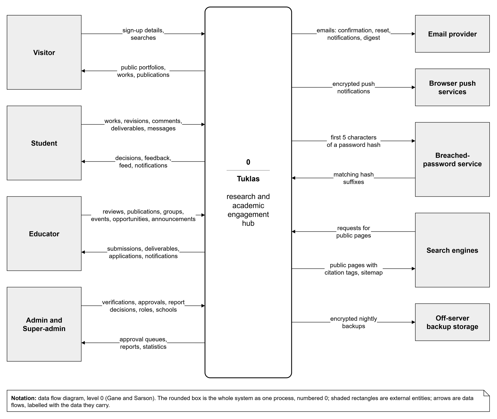
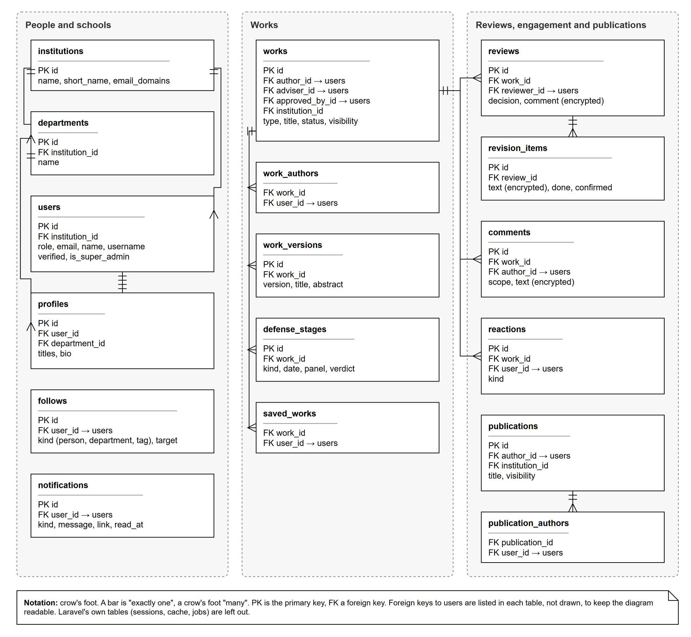
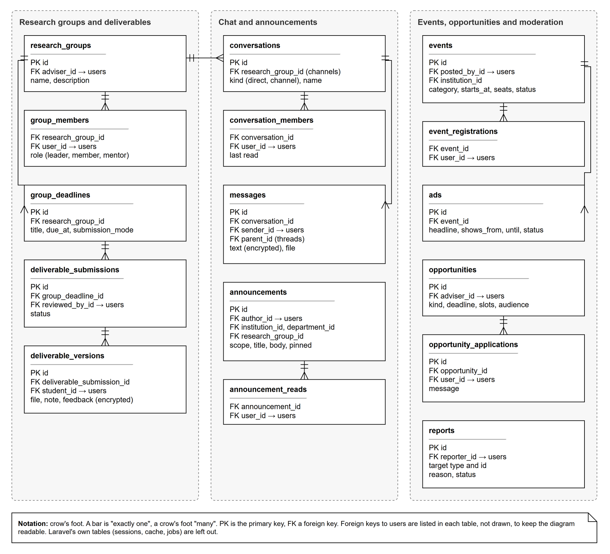
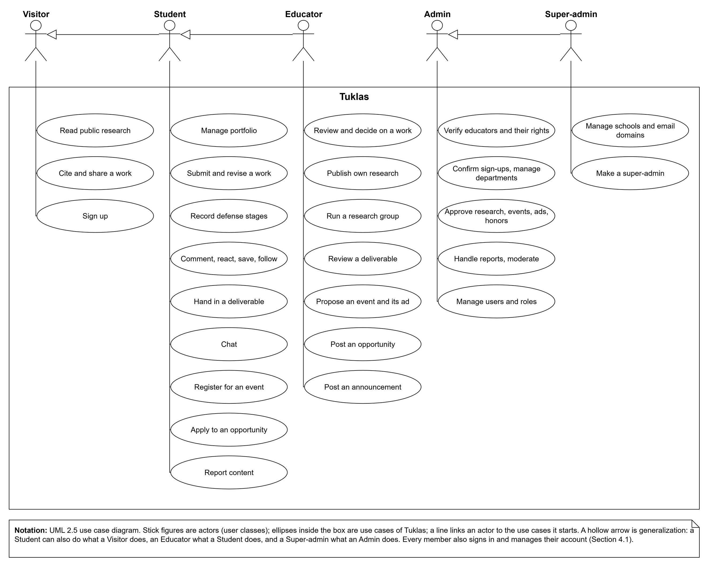
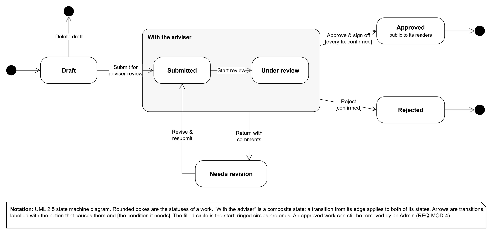

# Appendices

## Appendix A: Glossary

| Term | Meaning |
|---|---|
| Academic panel | The Admins of a school, acting as the panel that may approve a student's work in place of its adviser. |
| Admin | A school's research office staff member, who runs that school's part of Tuklas (Section 2.3). |
| Adviser (research adviser) | The Educator a Student chooses to review and approve a work. |
| API | Application programming interface: here, the JSON interface under /api through which the web application reads and writes all data. |
| Approval queue | The Admins' page with everything waiting for a decision. |
| Argon2id | The password-hashing method Tuklas uses to store passwords. |
| ASVS | OWASP Application Security Verification Standard (Reference 11). |
| Audit log | A record of moderation and administrative actions: who did what, and when. |
| Authenticator app | A phone app that shows the 6-digit codes for two-factor sign-in. |
| CSP | Content Security Policy: a header that tells the browser what a page may load. |
| CSRF | Cross-site request forgery; Tuklas protects every change with a CSRF token. |
| Deliverable | Work a Student hands in for a research group's deadline. |
| Draft | A work or publication that isn't submitted or published yet. |
| DPO | Data Protection Officer, named by each school under RA 10173. |
| Educator | A faculty member who advises research (Section 2.3). |
| Feature code | The short code of a feature in Section 4 (ACC, PORT, WORK, …), used in requirement tags. |
| Former member | How a deleted account is shown on the work it leaves behind. |
| HSTS | HTTP Strict Transport Security: tells browsers to use only HTTPS for the site. |
| JSON | JavaScript Object Notation, the data format of the API. |
| Migration | A versioned change to the database structure, kept in the source code. |
| NPC | The National Privacy Commission of the Philippines. |
| Opportunity | A mentorship, grant or call for submissions posted by an Educator. |
| OWASP | Open Worldwide Application Security Project. |
| Portfolio | A member's public academic page (Section 4.2). |
| Publication | An Educator's own research (Section 4.4). |
| PWA | Progressive web app: a website that can be installed and opened like an app. |
| RA 10173 | Republic Act No. 10173, the Data Privacy Act of 2012 (Reference 14). |
| Recovery code | A one-time code for signing in without the phone that holds the authenticator app. |
| Research group | An adviser-led group of Students, with chat channels, files, deadlines and deliverables. |
| Reverb | Laravel Reverb, the real-time server that sends live updates to browsers. |
| SMTP | Simple Mail Transfer Protocol, by which Tuklas hands its emails to the email provider. |
| SRS | Software Requirements Specification: this document. |
| Super-admin | An Admin who acts for every school on the site. |
| TBD | To be determined: information not yet available, listed in Appendix C. |
| TLS | Transport Layer Security, which encrypts HTTPS connections. |
| TOTP | Time-based one-time password: the 6-digit codes of two-factor sign-in. |
| Two-factor sign-in | Signing in with a password and a code from the member's phone. |
| VAPID | The key pair that identifies the Tuklas server to browser push services. |
| Visitor | Anyone using Tuklas without signing in. |
| Web Push | The web standard for sending notifications to browsers and phones. |
| WebSocket (WSS) | A lasting, encrypted connection over which the real-time server sends live updates. |
| Work | A Student's research paper, literary work or innovation (Section 4.3). |

## Appendix B: Analysis Models

This appendix holds the analysis models of Tuklas, each in a standard notation that its legend names. Their draw.io sources are in docs/srs/diagrams/, next to the pictures.

**Context diagram.** Figure 3 shows Tuklas as a single process, with the people and outside systems it exchanges data with. It complements the deployment diagram in Figure 1.

**Entity-relationship diagrams.** Figures 4 and 5 show the main tables of the database (Section 6, DB-7) and how they relate. Every table that names a person refers to users; those links are listed in each table rather than drawn.

**Use case diagram.** Figure 6 shows what each user class does with Tuklas. Each use case is described in detail by the feature in Section 4 that it belongs to.

**State diagram.** Figure 7 shows the life of a student's work, the core rule of Tuklas (BR-1, Section 4.3).

## Appendix C: To Be Determined List

| No. | What is to be determined | Where it appears |
|---|---|---|
| TBD-1 | The production host: where Tuklas runs for good. Release 1.0 runs on an Azure for Students virtual machine in Japan East. | 2.4, 5.4 (availability), 6 (LEG-4) |
| TBD-5 | The client's approved privacy notice, with the Data Protection Officer's contact details. | 2.7, 6 (LEG-3) |
| TBD-6 | Each school's Data Protection Officer and signed data processing agreement, whether registration with the National Privacy Commission is needed, and a breach plan. | 2.5, 2.7, 5.3 (SEC-15), 6 (LEG-1, LEG-2) |
| TBD-7 | The support contact that the user manual refers members to. | User manual, 1.5 and 8.3 |
| TBD-8 | Measurements of the performance requirements on the production server. | 5.1 (PERF-1 to PERF-3) |
| TBD-9 | The terms of use: who keeps the rights to uploaded works, and how they may be reused. | 6 (LEG-6) |

TBD-4, the user manual, was settled in this version: Section 2.6 lists it. Its number is not reused.
